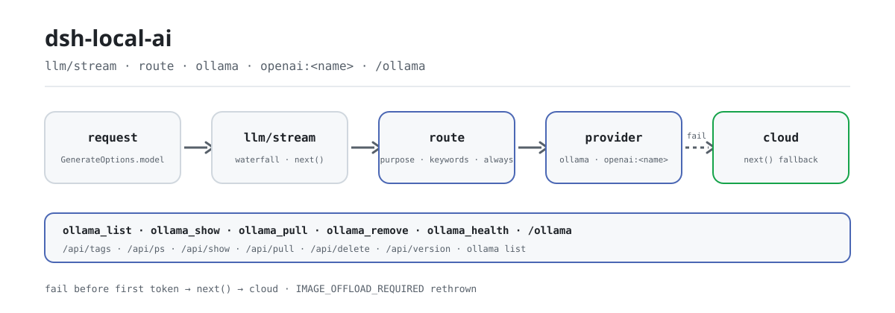

<div align="center">

<picture>
  <source media="(prefers-color-scheme: dark)" srcset="docs/assets/dsh-local-ai-flow-dark.svg">
  
</picture>

# dsh-local-ai

**Conecta Ollama a DeepSeek Harness y convierte los modelos locales en un proveedor de primera clase enrutable: las peticiones van a local según reglas y vuelven a la nube si fallan.**

Un plugin headless puramente host-side: descubre, descarga, elimina e inspecciona modelos locales, enruta por tipo de tarea o palabra clave y obtén un resumen de estado con `/ollama`, todo en un mismo bundle.

[Instalar](#instalación-en-tres-pasos) · [Configuración](#configuración) · [FAQ](#faq) · [简体中文](README.md) · [English](README.en.md) · [Español](README.es.md) · [Português](README.pt.md) · [हिन्दी](README.hi.md)

[](LICENSE)
[](#compatibilidad)
[](https://www.npmjs.com/package/dsh-local-ai)
[](https://github.com/PerryLink/dsh-local-ai/actions/workflows/ci.yml)
[](#compatibilidad)

[](https://github.com/PerryLink/dsh-local-ai/stargazers)
[](https://www.npmjs.com/package/dsh-local-ai)
[](https://dshfind.com/plugins/PerryLink/dsh-local-ai?ref=badge)
[](https://securityscorecards.dev/viewer/?uri=github.com/PerryLink/dsh-local-ai)
[](https://dsh.market/)
[](https://gitee.com/perrylink/dsh-local-ai)

```sh
dsh plugin --profile <name> add dsh-local-ai
```

</div>

<sub>Plugin de la comunidad, no afiliado a DeepSeek. Repositorio canónico: <https://github.com/PerryLink/dsh-local-ai> (Gitee es un espejo).</sub>

## Qué es

`dsh-local-ai` convierte Ollama en un proveedor local de primera clase dentro de DeepSeek Harness: registra la ruta del proveedor `ollama`, enruta las peticiones a modelos locales por tipo de tarea o palabra clave y vuelve a la nube automáticamente cuando una ruta local falla antes de producir contenido. Cinco herramientas cubren el descubrimiento, la descarga, la eliminación, la inspección y la salud de los modelos, y `/ollama` ofrece un resumen de estado en una pantalla. Todo habla con la API HTTP de Ollama (la CLI solo se usa para sondear el proceso); no se incluye ningún archivo de modelo y no se inventa ninguna entrada nueva visible para el modelo.

## Instalación en tres pasos

1. **Instala** (elige un canal):

   ```sh
   # canal git (último main; equivalente a git+https://github.com/PerryLink/dsh-local-ai.git)
   dsh plugin --profile web add github:PerryLink/dsh-local-ai
   # canal npm (versiones publicadas)
   dsh plugin --profile web add dsh-local-ai
   # canal tarball: pnpm pack en este repo y luego
   dsh plugin --profile web add ./dsh-local-ai-<version>.tgz
   ```

   El script `prepare` compila solo con dependencias de producción. Si pnpm informa `ERR_PNPM_IGNORED_BUILDS` para este paquete, añade `allowBuilds: { esbuild: true }` a tu `pnpm-workspace.yaml`: la CLI de `dsh` imprime el fragmento exacto.

2. **Configuración mínima de enrutado** (`route` viene comentado en `cordis.patch.yml`; asegúrate antes de que Ollama corre en `http://127.0.0.1:11434`):

   ```yaml
   - insert:
       - id: dsh-local-ai
         name: dsh-local-ai
         config:
           route:
             - model: llama3.2
               keywords: ["confidential", "offline"]
   ```

3. **Verifica que se monta**:

   ```sh
   dsh --profile web --dump-config | grep -A2 'id: dsh-local-ai'
   ```

   ```
   > /ollama
   ```

**Desinstalar**: `dsh plugin --profile web remove dsh-local-ai` (o elimina la fila del patch del perfil).

<details>
<summary>Instalar desde el mercado de DSH Desktop</summary>

Todos los plugins de PerryLink pueden explorarse en el mercado integrado de DSH Desktop: **Market → Sources → add source → pegar** `https://perrylink-dsh-catalog.perrylink.workers.dev/catalog-source.json` **→ seleccionarlo**. La instalación sigue pasando por la verificación de identidad npm del mercado y tu confirmación.

</details>

## Capacidades clave

`dsh-local-ai` convierte Ollama en un proveedor local de primera clase en DeepSeek Harness:

- **Descubrimiento y gestión** — `ollama_list` (modelos instalados, modelos en ejecución, uso de disco), `ollama_show` (tamaño de parámetros, cuantización, longitud de contexto), `ollama_pull` y `ollama_remove`.
- **Comprobación de salud** — vitalidad del proceso (vía la CLI `ollama`) y respuesta de la API (vía `/api/version`), reportadas como dos señales independientes.
- **Adaptador oficial** — la ruta del proveedor `ollama` se registra mediante `ctx.llm.registerAdapter` (`LlmAdapter`), con mapeo de modelos configurable y traducción de temperature / max-tokens / stop.
- **Backends compatibles con OpenAI** — LM Studio, vLLM y llama.cpp `--server` se registran cada uno como su propio proveedor `openai:<name>` a través del mismo seam `LlmAdapter`, reutilizando un único adaptador de OpenAI `/v1/chat/completions` (ruta solo de texto).
- **Enrutado local** — las reglas de `model_route` enrutan peticiones a un modelo local por tipo de tarea (`purpose`), palabra clave sin distinguir mayúsculas o `always`, con respaldo automático a la nube cuando la ruta local falla antes de producir contenido.
- **Comando `/ollama`** — un resumen de estado de una sola pasada: modelos, uso de disco, salud y sugerencias.
- **Cero dependencias, HTTP primero** — todo habla con la API HTTP de Ollama (la CLI solo se usa para sondear el proceso); no se incluye ningún archivo de modelo.

```text
request (loop)
   │ cascada llm/stream
   ├─ ¿coincide una regla? ──▶ enrutar a ollama ──▶ Ollama /api/chat (flujo NDJSON)
   │              └─▶ enrutar a openai:<name> ─▶ /v1/chat/completions (SSE)
   │                        └─ falla antes ─▶ volver a la nube (next())
   └─ sin coincidencia ──▶ proveedor en la nube
tools ──▶ /api/tags · /api/ps · /api/show · /api/pull · /api/delete
health ──▶ /api/version (API) + ollama list (proceso)
```

### Superficie de comandos y herramientas

| Superficie | Tipo | Qué hace |
|---|---|---|
| `ollama_list` | herramienta | Lista modelos instalados, modelos en ejecución y uso de disco |
| `ollama_show` | herramienta | Muestra tamaño de parámetros, cuantización, longitud de contexto, familia y formato |
| `ollama_pull` | herramienta | Descarga un modelo |
| `ollama_remove` | herramienta | Elimina un modelo |
| `ollama_health` | herramienta | Vitalidad del proceso + respuesta de la API |
| `/ollama` | comando | Resumen de estado de una pasada (modelos + salud + sugerencias) |

**Consume** los servicios públicos del host `ctx.llm` (`registerAdapter`), `ctx.tools`, `ctx.subprocess` (sonda de la CLI) y `ctx.commands`. No registra ningún cortocircuito de `llm/stream` por defecto: el listener de enrutado pasa de largo (`next()`) salvo que coincida una regla.

### Ejemplos

Son los puntos de entrada reales del plugin; instala una vez y llama a uno.

**Ejemplo detallado** — herramienta `ollama_list`, entrada:

```json
{}
```

Salida:

```text
1 local model(s), 100 B on disk
- llama3.2 (3B) — 100 B
```

*Observed from `plugins/dsh-local-ai/src/index.ts:83-90 (renderer); fixture/assertion at plugins/dsh-local-ai/test/index.spec.ts:31-35,68-82`*

**Rama de fallo** — entrada:

```text
{} (baseURL http://127.0.0.1:11434; nothing listening; no ollama binary on PATH)
```

Salida:

```text
{
  "api": {
    "ok": false,
    "error": "connection refused"
  },
  "process": {
    "present": false,
    "error": "\"ollama\" not found: subprocess-local: command \"ollama\" was not found on PATH"
  }
}
```

*Observed from `plugins/dsh-local-ai/src/health.ts:52-66,79-92; plugins/dsh-local-ai/test/health.spec.ts:23-28,52-57`*

**Ejemplos breves**: `ollama_show` · `ollama_pull`

## Configuración

Todos los parámetros son campos `Config` de Schemastery (modificables desde cordis.yml). Una sobrescritura dirigida por id reemplaza toda la fila: vuelve a declarar cada clave que necesites. `cordis.patch.yml` documenta cada clave en línea.

Claves más usadas:

| Clave | Valor por defecto | Significado |
|---|---|---|
| `baseURL` | `http://127.0.0.1:11434` | URL base de la API HTTP de Ollama; se añaden las rutas `/api/*` |
| `requestTimeoutMs` | `30000` | Tiempo de espera HTTP por petición (milisegundos) |
| `defaultContextWindow` | `8192` | Capacidad de contexto cuando un modelo no tiene un valor exacto |
| `maxTokens` | `4096` | Límite de salida por petición cuando un modelo no tiene un valor exacto |
| `vision` | `true` | Declara y serializa el soporte de imágenes cuando el modelo informa vision; `false` mantiene la ruta solo de texto |
| `models` | `[]` | Mapeos nombre visible en Harness → modelo de Ollama |
| `backends` | `[]` | Backends locales compatibles con OpenAI (LM Studio / vLLM / llama.cpp) |
| `route` | `[]` | Reglas de enrutado a modelos locales (gana la primera coincidencia) |

<details>
<summary>Tabla de configuración completa (27 claves)</summary>

| Clave | Valor por defecto | Significado |
|---|---|---|
| `baseURL` | `http://127.0.0.1:11434` | URL base de la API HTTP de Ollama; se añaden las rutas `/api/*` |
| `requestTimeoutMs` | `30000` | Tiempo de espera HTTP por petición (milisegundos) |
| `graceMs` | `15000` | Margen de terminación del subproceso para la sonda CLI de salud |
| `defaultContextWindow` | `8192` | Capacidad de contexto cuando un modelo no tiene un valor exacto |
| `maxTokens` | `4096` | Límite de salida por petición cuando un modelo no tiene un valor exacto |
| `temperature` | *(none)* | Temperatura de muestreo por defecto (0..2); omitida usa la del proveedor |
| `vision` | `true` | Declara y serializa el soporte de imágenes cuando el modelo informa vision; `false` mantiene la ruta solo de texto |
| `visionCacheTtlMs` | `30000` | Milisegundos que se cachea una sonda de capacidades `/api/show` (`0` desactiva la caché; un pull o remove invalida ese modelo) |
| `models` | `[]` | Mapeos nombre visible en Harness → modelo de Ollama |
| `models[].name` | *(required)* | Nombre de modelo visible en Harness (`GenerateOptions.model`) |
| `models[].model` | `= name` | Id del modelo de Ollama |
| `models[].contextWindow` | *(none)* | Capacidad de contexto de ese modelo |
| `models[].maxTokens` | *(none)* | Límite de salida de ese modelo |
| `models[].temperature` | *(none)* | Temperatura de muestreo de ese modelo |
| `backends` | `[]` | Backends locales compatibles con OpenAI (LM Studio / vLLM / llama.cpp) |
| `backends[].name` | *(required)* | Nombre del backend; registra el id de proveedor `openai:<name>` |
| `backends[].baseURL` | *(required)* | URL base del backend incluido `/v1`, p. ej. `http://127.0.0.1:1234/v1` |
| `backends[].apiKey` | *(none)* | API key bearer opcional (la mayoría de servidores locales la dejan vacía) |
| `backends[].models` | `[]` | Mapeos nombre visible → modelo del backend |
| `backends[].maxTokens` | `4096` | Límite de salida de ese backend cuando no hay valor exacto |
| `backends[].temperature` | *(none)* | Temperatura de muestreo de ese backend |
| `route` | `[]` | Reglas de enrutado a modelos locales (gana la primera coincidencia) |
| `route[].model` | *(required)* | Nombre del modelo local de destino |
| `route[].provider` | `ollama` | Id de proveedor de destino: `ollama` u `openai:<name>` |
| `route[].purpose` | *(none)* | Coincidencia por tipo de tarea: `compaction` / `session-title` |
| `route[].keywords` | `[]` | Palabras clave de petición sin distinguir mayúsculas |
| `route[].always` | `false` | Enruta todas las peticiones elegibles a este modelo |

</details>

Ejemplo de sobrescritura en el patch de tu perfil:

```yaml
- insert:
    - id: dsh-local-ai
      name: dsh-local-ai
      config:
        backends:
          - name: lmstudio
            baseURL: http://127.0.0.1:1234/v1
        route:
          - model: llama3.2
            keywords: ["confidential", "offline"]
          - model: qwen2.5-7b
            provider: openai:lmstudio
            always: true
```

## FAQ

<details>
<summary>¿Un Ollama caído o un endpoint inalcanzable rompe la conversación?</summary>

No. El listener de enrutado vuelve a la nube (`next()`) cuando una ruta local falla antes de producir su primer token, así que un Ollama muerto nunca bloquea una conversación; el resumen `/ollama` es best-effort y nunca lanza errores con el servidor caído. **Única excepción**: un fallo con `IMAGE_OFFLOAD_REQUIRED` se relanza en lugar de reintentarse en la nube (ver «Límites de seguridad»); un fallo después del primer token se reenvía tal cual y no se puede retirar.

</details>

<details>
<summary>¿A dónde van las peticiones? ¿El plugin guarda mis datos?</summary>

Solo hace peticiones `network:outbound` a los endpoints que configures en `baseURL` / `backends[].baseURL`. No accede al sistema de archivos, no crea almacenamiento y no guarda credenciales. Cada lista/detalle de modelos, dato de salud y mensaje de error que se muestra al modelo o al usuario se desinfecta antes: se eliminan el userinfo del endpoint y los parámetros secretos de consulta, se quitan los caracteres de control y se acotan las longitudes. Los resultados de herramientas y comandos los registran los propios seams tool/command del harness.

</details>

<details>
<summary>¿Reenruta mis peticiones a un modelo local en silencio por defecto?</summary>

No. La lista `route` está vacía por defecto; una petición llega a un modelo local solo mediante una regla explícita que coincida o una selección explícita del proveedor `ollama` / `openai:<name>`.

</details>

<details>
<summary>¿Compite con plugins como dsh-routing-suite por `llm/stream`?</summary>

No. `llm/stream` es un evento de difusión de Cordis: cada listener se ejecuta y ninguno puede dejar sin turno a otro; el listener de este plugin siempre delega en `next()` y solo cortocircuita cuando una ruta local está sirviendo de verdad. No ofrece ninguna clave de servicio, no registra ningún prefijo `webServer` y no muta globales. La argumentación punto por punto está en «Interoperabilidad con otros plugins DSH».

</details>

<details>
<summary>¿Puede ejecutar modelos con visión?</summary>

Sí, cuando el modelo informa la capacidad: un modelo cuyas capacidades de `/api/show` incluyen `vision` declara `inputModalities: ["text","image"]` y lleva cargas de imagen base64 en los mensajes de usuario (se desactiva con `vision: false`); los modelos solo de texto siguen rechazando contenido de imagen (`UNSUPPORTED_CONTENT`).

</details>

## Límites de seguridad

- **Sin reenrutado por defecto** — la lista `route` está vacía salvo que la actives; una petición llega a un modelo local solo mediante una regla explícita o una selección explícita del proveedor `ollama`.
- **Desinfección antes de mostrar** — las direcciones de endpoint y las rutas locales se desinfectan antes de llegar a la salida de herramientas, al comando `/ollama` o a los mensajes de error.
- **Cero modelos incluidos** — las descargas y el almacenamiento son responsabilidad de Ollama; en el paquete no se envía nada.
- **Fallo ruidoso, fallo contenido** — una configuración inválida hace fallar el montaje; una ruta local que falla antes de producir contenido vuelve a la nube (`next()`), así que un Ollama caído nunca bloquea una conversación. **Única excepción:** un fallo con `IMAGE_OFFLOAD_REQUIRED` se relanza en lugar de reintentarse en la nube — ese código es el circuito oficial de descarga de imágenes pidiendo a esta misma ruta local que suelte las imágenes retenidas, y el respaldo se saltaría el circuito mientras envía en silencio una petición solo-local a un proveedor remoto.
- **Visible para el modelo ⟺ registrado** — el enrutado solo cambia qué proveedor sirve una petición (el mensaje del assistant se registra con su procedencia `ollama`); no se inventa ninguna entrada nueva visible para el modelo.

## Permisos y datos

- **Permisos**: `network:outbound` hacia el endpoint de Ollama que configures; sin código nativo, sin acceso al sistema de archivos, sin almacenamiento.
- **Datos**: cada lista/detalle de modelos, dato de salud y mensaje de error que se muestra al modelo o al usuario se desinfecta antes de mostrarse (se eliminan el userinfo del endpoint y los parámetros secretos de consulta, se quitan los caracteres de control y se acotan las longitudes). Los resultados de herramientas y comandos los registran los propios mecanismos tool/command del harness.
- **Credenciales**: el plugin no guarda ni lee credenciales. Solo emite peticiones HTTP al endpoint que configures, más la sonda local del proceso `ollama list`.

## Limitaciones conocidas

- **npm 0.2.0-rc.2** — desarrollado y probado contra `@deepseek-ai/dsh@0.2.0-rc.2`; se espera que baselines más nuevos del harness funcionen, pero los verifica el workflow de compatibilidad mensual.
- **Visión cuando el modelo la informa** — los modelos cuyas capacidades de `/api/show` incluyen `vision` declaran `inputModalities: ["text","image"]` y llevan cargas de imagen base64 en los mensajes de usuario (se desactiva con `vision: false`); los modelos solo de texto siguen rechazando contenido de imagen (`UNSUPPORTED_CONTENT`).
- **Respaldo a mitad de flujo** — una vez que una ruta local ha empezado a producir contenido, un fallo posterior se reenvía (no se retira); solo un fallo antes del primer token vuelve a la nube.

## Interoperabilidad con otros plugins DSH

Verificado contra **DSH `0.2.0-rc.2`** (el runtime para el que se publica este README) y el conjunto de plugins de muchas estrellas sondeado el 2026-10-05.

Este plugin **no interfiere** con otros plugins, incluidos los de muchas estrellas ampliamente instalados:

- **Sin colisión de nombres de herramienta.** Cada herramienta lleva namespace; no se registra ningún nombre desnudo que ya posea una herramienta incluida u otro plugin.
- **Sin colisión de claves de servicio.** No ofrece ninguna clave de servicio, así que no puede colisionar en una.
- **Sin colisión de slots.** No registra ninguna clave de slot de cliente, así que no compite por un asiento de `shadows-shipped-ui`.
- **Sin colisión de rutas HTTP.** No registra ningún prefijo `webServer`.
- **Sin colisión de capa de patch.** El patch del bundle solo `insert`a su propia fila; nunca sobrescribe el `config` de una fila integrada.
- **Sin mutación global.** No parchea prototipos, no reescribe `process.env` ni reemplaza el dispatcher global de fetch.

**Los listeners de eventos compartidos no interfieren por construcción.** Observa el evento sensible al orden `llm/stream` con `ctx.on()` — el registro de difusión de Cordis, donde cada listener se ejecuta y ninguno puede dejar sin turno a otro. **Todos los listeners de aquí delegan en `next()`**, así que la cadena nunca se cortocircuita, y la mutación se aplica al valor que produjo `next()` en lugar de devolverse en su lugar:

- `llm/stream` — also used by `dsh-routing-suite` (7000★).

Evidencia estática: `dsh-plugin-doctor` K10–K13 informan `pass` en todas las comprobaciones de este repositorio.

## Compatibilidad

| Superficie | Estado |
|---|---|
| Harness | DeepSeek Harness `dsh-v0.2.1-alpha.1` (verificado el 2026-10-04: tres reglas de typecheck (instalado, CI, checkout) + 142 tests + puertas self-contained/artifacts; adaptada la unión de bloques de contenido de `0.1.7` — un resultado de herramienta es un mensaje de rol `tool` de primera clase, y un envoltorio `tool-result` anterior a `0.1.7` todavía se lee para registros antiguos). El rango de peers admite todas las líneas soportadas: `>=0.1.2-rc.1 <0.2.0 \|\| >=0.1.5-alpha.1 <0.2.0 \|\| >=0.1.6-0 <0.2.0 \|\| >=0.1.7-0 <0.2.0 \|\| >=0.2.0-0 <0.3.0 \|\| >=0.2.1-0 <0.3.0 \|\| >=0.2.2-0 <0.3.0`; los pins de dev/test son `0.2.0-rc.2`. |
| Node | `^22.19.0 \|\| >=24.9.0` |
| Backend | [Ollama](https://ollama.com) (API HTTP local + sonda CLI) |
| Modelo | Ruta solo de texto (`inputModalities: ['text']`); se admiten llamadas a herramientas y resultados de herramientas |

## Ecosistema y calidad

- [Espejo en Gitee](https://gitee.com/perrylink/dsh-local-ai) (espejo sincronizado; GitHub es el canónico)
- [Página del plugin en dshfind](https://dshfind.com/plugins/PerryLink/dsh-local-ai) (instalaciones y ranking)
- [Informe OpenSSF Scorecard](https://securityscorecards.dev/viewer/?uri=github.com/PerryLink/dsh-local-ai) (impulsado por [.github/workflows/scorecard.yml](.github/workflows/scorecard.yml))
- [Informe de verificación de dsh-plugin-doctor](https://github.com/PerryLink/dsh-plugin-doctor#verified-徽章) (K10–K13 todos `pass`)
- [DSH Market](https://dsh.market/) (listado)
- **Canal de la tienda 1024**: una vez `npm i -g dsh1024`, luego `dsh1024 plugin --profile web add dsh-local-ai` (cuenta para el ranking de instalaciones de [deepseek1024.com](https://deepseek1024.com))
- [Base de conocimiento del ecosistema](https://perrylink.github.io/dsh-plugin-guide/) — datos medidos, no marketing: guía de desarrollo de plugins · datos de selección · criterios de mantenimiento

## Desarrollo

```sh
pnpm install        # node ^22.19 || >=24
pnpm run typecheck  # tsc: src + tests against the published 0.2.0-rc.2 types
pnpm run typecheck:ci  # strict tsc against published rc.2 types (skipLibCheck off)
pnpm test           # vitest: real Context/LlmRuntime/ToolRuntime/CommandRuntime/subprocess seams
pnpm run test:coverage  # coverage gate (90/80/90/90)
pnpm run build      # tsdown bundle + tsc declarations (lib/)
pnpm run verify:self-contained  # dependency specs resolve from the registry
pnpm run verify:artifacts       # built ESM face + bundle patch present
node scripts/check-readme-sync.mjs  # five-language README sync gate
node scripts/check-endpoints.mjs  # M3 endpoint-liveness probe (Ollama /api/version)
pnpm pack           # the published tarball
```

La salida de build es `lib/` (`pnpm run build` empaqueta con tsdown y emite las declaraciones de tsc). Las imágenes del README se generan programáticamente con [`scripts/gen-readme-assets.py`](scripts/gen-readme-assets.py) (Python + Pillow) y se pueden volver a ejecutar sin riesgo.

Topics: `dsh`, `dsh-plugin`, `deepseek-harness`, `deepseek`, `cordis`, `ollama`, `local-llm`, `local-models`, `offline`, `privacy`, `model-routing`

## Familia y agradecimientos

Este proyecto forma parte de la familia de plugins de DeepSeek Harness de [PerryLink](https://github.com/PerryLink) (95 plugins, todos Apache-2.0). Si te resulta útil, **una estrella ayuda a que la siguiente persona lo encuentre**: no desbloquea nada.

- [@PerryLink](https://github.com/PerryLink) — creador y mantenedor: adaptador, enrutado, herramientas, comprobación de salud, desinfección y los documentos en cinco idiomas.
- [@LABEST-IA](https://github.com/LABEST-IA) — corrección del CallId de llamadas a herramientas (PR #2) y los informes de slot de llamadas a herramientas y soporte de visión (issues #1, #3, #5).

<details>
<summary>Expandir todos los plugins</summary>

| Plugin | Estado |
|---|---|
| **[dsh-aqua-input-check](https://github.com/PerryLink/dsh-aqua-input-check)** |  |
| **[dsh-archive-check](https://github.com/PerryLink/dsh-archive-check)** |  |
| **[dsh-auto-review](https://github.com/PerryLink/dsh-auto-review)** |  |
| **[dsh-autotier](https://github.com/PerryLink/dsh-autotier)** | 🧊 CONGELADO — ver el README del repo |
| **[dsh-bid-ca-precheck](https://github.com/PerryLink/dsh-bid-ca-precheck)** |  |
| **[dsh-bid-qual-check](https://github.com/PerryLink/dsh-bid-qual-check)** |  |
| **[dsh-cert-mcp](https://github.com/PerryLink/dsh-cert-mcp)** | 🧊 CONGELADO — ver el README del repo |
| **[dsh-checkpoint-rewind](https://github.com/PerryLink/dsh-checkpoint-rewind)** |  |
| **[dsh-click](https://github.com/PerryLink/dsh-click)** |  |
| **[dsh-composer-history](https://github.com/PerryLink/dsh-composer-history)** |  |
| **[dsh-contract-stance](https://github.com/PerryLink/dsh-contract-stance)** |  |
| **[dsh-customs-doc-check](https://github.com/PerryLink/dsh-customs-doc-check)** |  |
| **[dsh-data-quality](https://github.com/PerryLink/dsh-data-quality)** | 🧊 CONGELADO — ver el README del repo |
| **[dsh-demurrage-ledger](https://github.com/PerryLink/dsh-demurrage-ledger)** |  |
| **[dsh-doublecheck](https://github.com/PerryLink/dsh-doublecheck)** |  |
| **[dsh-drill-script-check](https://github.com/PerryLink/dsh-drill-script-check)** |  |
| **[dsh-eia-guide-check](https://github.com/PerryLink/dsh-eia-guide-check)** |  |
| **[dsh-emergency-plan](https://github.com/PerryLink/dsh-emergency-plan)** |  |
| **[dsh-essay-rubric-check](https://github.com/PerryLink/dsh-essay-rubric-check)** |  |
| **[dsh-evidence-check](https://github.com/PerryLink/dsh-evidence-check)** |  |
| **[dsh-export-ctl-check](https://github.com/PerryLink/dsh-export-ctl-check)** |  |
| **[dsh-fast](https://github.com/PerryLink/dsh-fast)** |  |
| **[dsh-fmea-table-check](https://github.com/PerryLink/dsh-fmea-table-check)** |  |
| **[dsh-forecast-penalty](https://github.com/PerryLink/dsh-forecast-penalty)** |  |
| **[dsh-fund-research](https://github.com/PerryLink/dsh-fund-research)** |  |
| **[dsh-github](https://github.com/PerryLink/dsh-github)** |  |
| **[dsh-gongwen-flow-check](https://github.com/PerryLink/dsh-gongwen-flow-check)** |  |
| **[dsh-gongwen-word-check](https://github.com/PerryLink/dsh-gongwen-word-check)** |  |
| **[dsh-guard-plan-qc](https://github.com/PerryLink/dsh-guard-plan-qc)** |  |
| **[dsh-hazchem-check](https://github.com/PerryLink/dsh-hazchem-check)** |  |
| **[dsh-hazplan-check](https://github.com/PerryLink/dsh-hazplan-check)** |  |
| **[dsh-hidden-risk-map](https://github.com/PerryLink/dsh-hidden-risk-map)** |  |
| **[dsh-hs-classify](https://github.com/PerryLink/dsh-hs-classify)** |  |
| **[dsh-icd-rule-check](https://github.com/PerryLink/dsh-icd-rule-check)** |  |
| **[dsh-industry-research](https://github.com/PerryLink/dsh-industry-research)** |  |
| **[dsh-lawcite-adapter](https://github.com/PerryLink/dsh-lawcite-adapter)** |  |
| **[dsh-laya](https://github.com/PerryLink/dsh-laya)** |  |
| **[dsh-lc-doc-check](https://github.com/PerryLink/dsh-lc-doc-check)** |  |
| **[dsh-learning-gap-check](https://github.com/PerryLink/dsh-learning-gap-check)** |  |
| **[dsh-library](https://github.com/PerryLink/dsh-library)** |  |
| **[dsh-local-ai](https://github.com/PerryLink/dsh-local-ai)** |  |
| **[dsh-lsp-actions](https://github.com/PerryLink/dsh-lsp-actions)** |  |
| **[dsh-mask](https://github.com/PerryLink/dsh-mask)** |  |
| **[dsh-mcp-panel](https://github.com/PerryLink/dsh-mcp-panel)** |  |
| **[dsh-medrec-qc](https://github.com/PerryLink/dsh-medrec-qc)** |  |
| **[dsh-memento](https://github.com/PerryLink/dsh-memento)** | 🧊 CONGELADO — ver el README del repo |
| **[dsh-nsfc-form-check](https://github.com/PerryLink/dsh-nsfc-form-check)** |  |
| **[dsh-nurse-record-check](https://github.com/PerryLink/dsh-nurse-record-check)** |  |
| **[dsh-observe](https://github.com/PerryLink/dsh-observe)** |  |
| **[dsh-origin-rvc-check](https://github.com/PerryLink/dsh-origin-rvc-check)** |  |
| **[dsh-ota-review-check](https://github.com/PerryLink/dsh-ota-review-check)** |  |
| **[dsh-output-styles](https://github.com/PerryLink/dsh-output-styles)** |  |
| **[dsh-paper-doc-adapter](https://github.com/PerryLink/dsh-paper-doc-adapter)** |  |
| **[dsh-permission-rules](https://github.com/PerryLink/dsh-permission-rules)** |  |
| **[dsh-permit-report-check](https://github.com/PerryLink/dsh-permit-report-check)** |  |
| **[dsh-pipeline-check](https://github.com/PerryLink/dsh-pipeline-check)** |  |
| **[dsh-pleading-draft](https://github.com/PerryLink/dsh-pleading-draft)** |  |
| **[dsh-plugin-doctor](https://github.com/PerryLink/dsh-plugin-doctor)** | 🚫 RETIRADO (repo archivado) |
| **[dsh-plugin-guide](https://github.com/PerryLink/dsh-plugin-guide)** |  |
| **[dsh-plugin-kit](https://github.com/PerryLink/dsh-plugin-kit)** | 🚫 RETIRADO (repo archivado) |
| **[dsh-plugin-upgrade](https://github.com/PerryLink/dsh-plugin-upgrade)** | 🚫 RETIRADO (repo archivado) |
| **[dsh-policy-brief-draft](https://github.com/PerryLink/dsh-policy-brief-draft)** |  |
| **[dsh-power-loss-split](https://github.com/PerryLink/dsh-power-loss-split)** |  |
| **[dsh-power-ticket-check](https://github.com/PerryLink/dsh-power-ticket-check)** |  |
| **[dsh-ppap-check](https://github.com/PerryLink/dsh-ppap-check)** |  |
| **[dsh-protest-deadline](https://github.com/PerryLink/dsh-protest-deadline)** |  |
| **[dsh-railway-window](https://github.com/PerryLink/dsh-railway-window)** |  |
| **[dsh-repair-order-qc](https://github.com/PerryLink/dsh-repair-order-qc)** |  |
| **[dsh-research-report](https://github.com/PerryLink/dsh-research-report)** |  |
| **[dsh-review-reply-check](https://github.com/PerryLink/dsh-review-reply-check)** |  |
| **[dsh-rulefile-check](https://github.com/PerryLink/dsh-rulefile-check)** |  |
| **[dsh-safety-brief-check](https://github.com/PerryLink/dsh-safety-brief-check)** |  |
| **[dsh-score](https://github.com/PerryLink/dsh-score)** | 🧊 CONGELADO — ver el README del repo |
| **[dsh-session-sync](https://github.com/PerryLink/dsh-session-sync)** |  |
| **[dsh-site-log-check](https://github.com/PerryLink/dsh-site-log-check)** |  |
| **[dsh-skill-pack-security](https://github.com/PerryLink/dsh-skill-pack-security)** |  |
| **[dsh-soe-decision-check](https://github.com/PerryLink/dsh-soe-decision-check)** |  |
| **[dsh-soilwater-check](https://github.com/PerryLink/dsh-soilwater-check)** |  |
| **[dsh-sop-sync-check](https://github.com/PerryLink/dsh-sop-sync-check)** |  |
| **[dsh-spc-gbt-adapter](https://github.com/PerryLink/dsh-spc-gbt-adapter)** |  |
| **[dsh-talk](https://github.com/PerryLink/dsh-talk)** |  |
| **[dsh-tender-extract](https://github.com/PerryLink/dsh-tender-extract)** |  |
| **[dsh-tender-matrix](https://github.com/PerryLink/dsh-tender-matrix)** |  |
| **[dsh-test-drive](https://github.com/PerryLink/dsh-test-drive)** |  |
| **[dsh-ticktick](https://github.com/PerryLink/dsh-ticktick)** | 🚫 RETIRADO (repo archivado) |
| **[dsh-translate](https://github.com/PerryLink/dsh-translate)** |  |
| **[dsh-warranty-calc](https://github.com/PerryLink/dsh-warranty-calc)** |  |
| **[dsh-budget](https://github.com/PerryLink/dsh-budget)** | 🧊 CONGELADO — ver el README del repo |
| **[dsh-claude-move](https://github.com/PerryLink/dsh-claude-move)** | 🧊 CONGELADO — ver el README del repo |
| **[dsh-defend](https://github.com/PerryLink/dsh-defend)** | 🧊 CONGELADO — ver el README del repo |
| **[dsh-draw](https://github.com/PerryLink/dsh-draw)** | 🧊 CONGELADO — ver el README del repo |
| **[dsh-reach](https://github.com/PerryLink/dsh-reach)** | 🧊 CONGELADO — ver el README del repo |
| **[dsh-background-agents](https://github.com/PerryLink/dsh-background-agents)** | 🚫 RETIRADO (repo archivado) |
| **[dsh-session-pin](https://github.com/PerryLink/dsh-session-pin)** | 🚫 RETIRADO (repo archivado) |
| **[dsh-team-rooms](https://github.com/PerryLink/dsh-team-rooms)** | 🚫 RETIRADO (repo archivado) |

</details>

## Licencia

[LICENSE](LICENSE) (Apache License 2.0) © 2026 dsh-local-ai contributors

<p align="center"><sub>Apache-2.0 · Plugin de la comunidad, no afiliado a DeepSeek.</sub></p>
