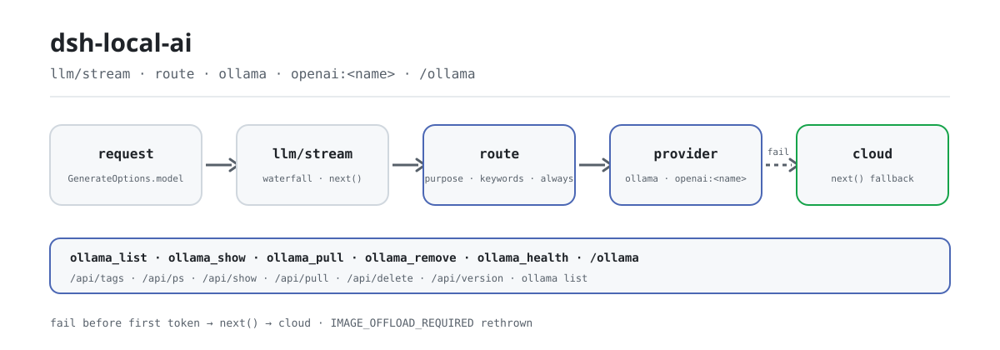

<div align="center">

<picture>
  <source media="(prefers-color-scheme: dark)" srcset="docs/assets/dsh-local-ai-flow-dark.svg">
  
</picture>

# dsh-local-ai

**Ollama को DeepSeek Harness से जोड़ें और स्थानीय मॉडलों को राउट करने योग्य प्रथम-श्रेणी प्रदाता बनाएँ — अनुरोध नियम के अनुसार स्थानीय जाते हैं और विफल होने पर बादल पर लौट आते हैं।**

शुद्ध host-side हेडलेस प्लगइन: स्थानीय मॉडल खोजें, खींचें, हटाएँ और निरीक्षण करें, कार्य-प्रकार या कीवर्ड से राउट करें, और `/ollama` से एक-नज़र में स्थिति देखें — सब एक ही bundle में।

[इंस्टॉल](#तीन-चरणों-में-शुरुआत) · [कॉन्फ़िगरेशन](#कॉन्फ़िगरेशन) · [FAQ](#faq) · [简体中文](README.md) · [English](README.en.md) · [Español](README.es.md) · [Português](README.pt.md) · [हिन्दी](README.hi.md)

[](LICENSE)
[](#संगतता)
[](https://www.npmjs.com/package/dsh-local-ai)
[](https://github.com/PerryLink/dsh-local-ai/actions/workflows/ci.yml)
[](#संगतता)

[](https://github.com/PerryLink/dsh-local-ai/stargazers)
[](https://www.npmjs.com/package/dsh-local-ai)
[](https://dshfind.com/plugins/PerryLink/dsh-local-ai?ref=badge)
[](https://securityscorecards.dev/viewer/?uri=github.com/PerryLink/dsh-local-ai)
[](https://dsh.market/)
[](https://gitee.com/perrylink/dsh-local-ai)

```sh
dsh plugin --profile <name> add dsh-local-ai
```

</div>

<sub>सामुदायिक प्लगइन, DeepSeek से असंबद्ध। कैनोनिकल रिपॉज़िटरी: <https://github.com/PerryLink/dsh-local-ai> (Gitee एक मिरर है)।</sub>

## यह क्या है

`dsh-local-ai` Ollama को DeepSeek Harness के भीतर प्रथम-श्रेणी का स्थानीय प्रदाता बनाता है: यह `ollama` प्रदाता रूट पंजीकृत करता है, अनुरोधों को कार्य-प्रकार या कीवर्ड के अनुसार स्थानीय मॉडलों पर भेजता है, और स्थानीय रूट के सामग्री उत्पन्न करने से पहले विफल होने पर अपने आप बादल पर लौट आता है। पाँच टूल मॉडलों की खोज, खींचना, हटाना, निरीक्षण और हेल्थ कवर करते हैं, और `/ollama` एक स्क्रीन में स्थिति का सार देता है। सब कुछ Ollama के HTTP API से बात करता है (CLI केवल प्रोसेस जाँच के लिए है); कोई मॉडल फ़ाइल बंडल नहीं होती और मॉडल को दिखने वाला कोई नया इनपुट नहीं गढ़ा जाता।

## तीन चरणों में शुरुआत

1. **इंस्टॉल करें** (एक चैनल चुनें):

   ```sh
   # git चैनल (नवीनतम main; git+https://github.com/PerryLink/dsh-local-ai.git के बराबर)
   dsh plugin --profile web add github:PerryLink/dsh-local-ai
   # npm चैनल (प्रकाशित रिलीज़)
   dsh plugin --profile web add dsh-local-ai
   # tarball चैनल: इस रेपो में pnpm pack करके
   dsh plugin --profile web add ./dsh-local-ai-<version>.tgz
   ```

   `prepare` स्क्रिप्ट केवल प्रोडक्शन निर्भरताओं से बिल्ड करती है। यदि pnpm इस पैकेज के लिए `ERR_PNPM_IGNORED_BUILDS` बताए, तो अपने `pnpm-workspace.yaml` में `allowBuilds: { esbuild: true }` जोड़ें — `dsh` CLI ठीक वही स्निपेट छापती है।

2. **न्यूनतम राउटिंग कॉन्फ़िग** (`route` `cordis.patch.yml` में टिप्पणी रूप में है; पहले सुनिश्चित करें कि Ollama `http://127.0.0.1:11434` पर चल रहा है):

   ```yaml
   - insert:
       - id: dsh-local-ai
         name: dsh-local-ai
         config:
           route:
             - model: llama3.2
               keywords: ["confidential", "offline"]
   ```

3. **माउंट सत्यापित करें**:

   ```sh
   dsh --profile web --dump-config | grep -A2 'id: dsh-local-ai'
   ```

   ```
   > /ollama
   ```

**अनइंस्टॉल**: `dsh plugin --profile web remove dsh-local-ai` (या प्रोफ़ाइल पैच से वह पंक्ति हटाएँ)।

<details>
<summary>DSH Desktop मार्केट से इंस्टॉल करें</summary>

सभी PerryLink प्लगइन DSH Desktop के अंतर्निहित मार्केट में ब्राउज़ किए जा सकते हैं: **Market → Sources → Add source → पेस्ट करें** `https://perrylink-dsh-catalog.perrylink.workers.dev/catalog-source.json` **→ चुनें**। इंस्टॉलेशन के लिए मार्केट की npm पहचान जाँच और आपकी पुष्टि आवश्यक रहती है।

</details>

## मुख्य क्षमताएँ

`dsh-local-ai` Ollama को DeepSeek Harness में प्रथम-श्रेणी का स्थानीय प्रदाता बनाता है:

- **खोज और प्रबंधन** — `ollama_list` (इंस्टॉल किए मॉडल, चल रहे मॉडल, डिस्क उपयोग), `ollama_show` (पैरामीटर आकार, क्वांटाइज़ेशन, कॉन्टेक्स्ट लंबाई), `ollama_pull` और `ollama_remove`।
- **हेल्थ चेक** — प्रोसेस की जीवितता (`ollama` CLI से) और API की प्रतिक्रिया (`/api/version` से), दो स्वतंत्र संकेतों के रूप में रिपोर्ट।
- **आधिकारिक एडाप्टर** — `ollama` प्रदाता रूट `ctx.llm.registerAdapter` (`LlmAdapter`) से पंजीकृत होता है, कॉन्फ़िगर करने योग्य मॉडल मैपिंग और temperature / max-tokens / stop अनुवाद के साथ।
- **OpenAI-संगत बैकएंड** — LM Studio, vLLM और llama.cpp `--server` में से प्रत्येक उसी `LlmAdapter` seam से अपना `openai:<name>` प्रदाता पंजीकृत करता है, एक ही OpenAI `/v1/chat/completions` एडाप्टर दोबारा इस्तेमाल करते हुए (केवल-टेक्स्ट रूट)।
- **स्थानीय राउटिंग** — `model_route` नियम अनुरोधों को कार्य-प्रकार (`purpose`), केस-असंवेदनशील कीवर्ड या `always` से स्थानीय मॉडल पर भेजते हैं, और स्थानीय रूट के सामग्री उत्पन्न करने से पहले विफल होने पर अपने आप बादल पर फ़ॉलबैक होता है।
- **`/ollama` कमांड** — एक-पास में स्थिति का सार: मॉडल, डिस्क उपयोग, हेल्थ और सुझाव।
- **शून्य निर्भरता, HTTP पहले** — सब कुछ Ollama के HTTP API से बात करता है (CLI केवल प्रोसेस जाँच के लिए है); कोई मॉडल फ़ाइल बंडल नहीं होती।

```text
request (loop)
   │ llm/stream वॉटरफ़ॉल
   ├─ नियम मेल खाता है? ──▶ ollama पर राउट ──▶ Ollama /api/chat (NDJSON स्ट्रीम)
   │              └─▶ openai:<name> पर राउट ─▶ /v1/chat/completions (SSE)
   │                        └─ पहले विफल ─▶ बादल पर फ़ॉलबैक (next())
   └─ कोई मेल नहीं ──▶ बादल प्रदाता
tools ──▶ /api/tags · /api/ps · /api/show · /api/pull · /api/delete
health ──▶ /api/version (API) + ollama list (प्रोसेस)
```

### कमांड और टूल सतह

| सतह | प्रकार | क्या करता है |
|---|---|---|
| `ollama_list` | टूल | इंस्टॉल किए मॉडल, चल रहे मॉडल और डिस्क उपयोग की सूची |
| `ollama_show` | टूल | पैरामीटर आकार, क्वांटाइज़ेशन, कॉन्टेक्स्ट लंबाई, family, format दिखाता है |
| `ollama_pull` | टूल | मॉडल खींचता (डाउनलोड करता) है |
| `ollama_remove` | टूल | मॉडल हटाता है |
| `ollama_health` | टूल | प्रोसेस जीवितता + API प्रतिक्रिया |
| `/ollama` | कमांड | एक-पास स्थिति सार (मॉडल + हेल्थ + सुझाव) |

**उपभोग** करता है सार्वजनिक host सेवाएँ `ctx.llm` (`registerAdapter`), `ctx.tools`, `ctx.subprocess` (CLI जाँच) और `ctx.commands`। डिफ़ॉल्ट रूप से `llm/stream` का कोई शॉर्ट-सर्किट पंजीकृत नहीं होता — राउटिंग लिसनर बिना नियम मेल खाने पर पास-थ्रू (`next()`) करता है।

### उदाहरण

ये प्लगइन के वास्तविक प्रवेश बिंदु हैं; एक बार इंस्टॉल करके एक चलाएँ।

**विस्तृत उदाहरण** — टूल `ollama_list`, इनपुट:

```json
{}
```

आउटपुट:

```text
1 local model(s), 100 B on disk
- llama3.2 (3B) — 100 B
```

*Observed from `plugins/dsh-local-ai/src/index.ts:83-90 (renderer); fixture/assertion at plugins/dsh-local-ai/test/index.spec.ts:31-35,68-82`*

**विफलता शाखा** — इनपुट:

```text
{} (baseURL http://127.0.0.1:11434; nothing listening; no ollama binary on PATH)
```

आउटपुट:

```text
{
  "api": {
    "ok": false,
    "error": "connection refused"
  },
  "process": {
    "present": false,
    "error": "\"ollama\" not found: subprocess-local: command \"ollama\" was not found on PATH"
  }
}
```

*Observed from `plugins/dsh-local-ai/src/health.ts:52-66,79-92; plugins/dsh-local-ai/test/health.spec.ts:23-28,52-57`*

**संक्षिप्त उदाहरण**: `ollama_show` · `ollama_pull`

## कॉन्फ़िगरेशन

सभी समायोज्य Schemastery `Config` फ़ील्ड हैं (cordis.yml से बदले जा सकते हैं)। id-लक्षित ओवरराइड पूरी पंक्ति बदल देता है — जिन भी कुंजियों की ज़रूरत हो, सब दोबारा लिखें। `cordis.patch.yml` हर कुंजी को इनलाइन समझाता है।

सबसे अधिक उपयोग होने वाली कुंजियाँ:

| कुंजी | डिफ़ॉल्ट | अर्थ |
|---|---|---|
| `baseURL` | `http://127.0.0.1:11434` | Ollama HTTP API का आधार URL; `/api/*` पथ जोड़े जाते हैं |
| `requestTimeoutMs` | `30000` | प्रति-अनुरोध HTTP टाइमआउट (मिलीसेकंड) |
| `defaultContextWindow` | `8192` | जब मॉडल का सटीक मान न हो तो कॉन्टेक्स्ट क्षमता |
| `maxTokens` | `4096` | जब मॉडल का सटीक मान न हो तो प्रति-अनुरोध आउटपुट सीमा |
| `vision` | `true` | मॉडल के vision बताने पर इमेज समर्थन घोषित और सीरियल करें; `false` रूट को केवल-टेक्स्ट रखता है |
| `models` | `[]` | Harness में दिखने वाला नाम → Ollama मॉडल मैपिंग |
| `backends` | `[]` | OpenAI-संगत स्थानीय बैकएंड (LM Studio / vLLM / llama.cpp) |
| `route` | `[]` | स्थानीय मॉडल राउटिंग नियम (पहला मेल जीतता है) |

<details>
<summary>पूर्ण कॉन्फ़िगरेशन तालिका (27 कुंजियाँ)</summary>

| कुंजी | डिफ़ॉल्ट | अर्थ |
|---|---|---|
| `baseURL` | `http://127.0.0.1:11434` | Ollama HTTP API का आधार URL; `/api/*` पथ जोड़े जाते हैं |
| `requestTimeoutMs` | `30000` | प्रति-अनुरोध HTTP टाइमआउट (मिलीसेकंड) |
| `graceMs` | `15000` | हेल्थ-चेक CLI जाँच के लिए सबप्रोसेस समाप्ति की छूट |
| `defaultContextWindow` | `8192` | जब मॉडल का सटीक मान न हो तो कॉन्टेक्स्ट क्षमता |
| `maxTokens` | `4096` | जब मॉडल का सटीक मान न हो तो प्रति-अनुरोध आउटपुट सीमा |
| `temperature` | *(none)* | डिफ़ॉल्ट सैंपलिंग तापमान (0..2); छोड़ने पर प्रदाता का डिफ़ॉल्ट |
| `vision` | `true` | मॉडल के vision बताने पर इमेज समर्थन घोषित और सीरियल करें; `false` रूट को केवल-टेक्स्ट रखता है |
| `visionCacheTtlMs` | `30000` | `/api/show` क्षमता जाँच कितने मिलीसेकंड कैश रहती है (`0` कैश बंद; pull/remove उस मॉडल को अमान्य कर देता है) |
| `models` | `[]` | Harness में दिखने वाला नाम → Ollama मॉडल मैपिंग |
| `models[].name` | *(required)* | Harness में दिखने वाला मॉडल नाम (`GenerateOptions.model`) |
| `models[].model` | `= name` | Ollama मॉडल id |
| `models[].contextWindow` | *(none)* | उस मॉडल की कॉन्टेक्स्ट क्षमता |
| `models[].maxTokens` | *(none)* | उस मॉडल की आउटपुट सीमा |
| `models[].temperature` | *(none)* | उस मॉडल का सैंपलिंग तापमान |
| `backends` | `[]` | OpenAI-संगत स्थानीय बैकएंड (LM Studio / vLLM / llama.cpp) |
| `backends[].name` | *(required)* | बैकएंड नाम; प्रदाता id `openai:<name>` पंजीकृत करता है |
| `backends[].baseURL` | *(required)* | बैकएंड आधार URL जिसमें `/v1` शामिल है, जैसे `http://127.0.0.1:1234/v1` |
| `backends[].apiKey` | *(none)* | वैकल्पिक bearer API key (अधिकांश स्थानीय सर्वर इसे खाली छोड़ते हैं) |
| `backends[].models` | `[]` | Harness में दिखने वाला नाम → बैकएंड मॉडल मैपिंग |
| `backends[].maxTokens` | `4096` | उस बैकएंड की आउटपुट सीमा जब सटीक मान न हो |
| `backends[].temperature` | *(none)* | उस बैकएंड का सैंपलिंग तापमान |
| `route` | `[]` | स्थानीय मॉडल राउटिंग नियम (पहला मेल जीतता है) |
| `route[].model` | *(required)* | लक्ष्य स्थानीय मॉडल नाम |
| `route[].provider` | `ollama` | लक्ष्य प्रदाता id: `ollama` या `openai:<name>` |
| `route[].purpose` | *(none)* | कार्य-प्रकार मिलान: `compaction` / `session-title` |
| `route[].keywords` | `[]` | केस-असंवेदनशील अनुरोध कीवर्ड |
| `route[].always` | `false` | हर योग्य अनुरोध इस मॉडल पर भेजें |

</details>

आपके प्रोफ़ाइल पैच में ओवरराइड का उदाहरण:

```yaml
- insert:
    - id: dsh-local-ai
      name: dsh-local-ai
      config:
        backends:
          - name: lmstudio
            baseURL: http://127.0.0.1:1234/v1
        route:
          - model: llama3.2
            keywords: ["confidential", "offline"]
          - model: qwen2.5-7b
            provider: openai:lmstudio
            always: true
```

## FAQ

<details>
<summary>Ollama बंद हो या एंडपॉइंट न पहुँचे, तो बातचीत टूट जाएगी?</summary>

नहीं। स्थानीय रूट पहला token बनाने से पहले विफल होने पर राउटिंग लिसनर बादल पर (`next()`) लौट जाता है, इसलिए मरा हुआ Ollama कभी बातचीत नहीं रोकता; `/ollama` सार best-effort है और सर्वर बंद होने पर कभी त्रुटि नहीं फेंकता। **एक अपवाद**: `IMAGE_OFFLOAD_REQUIRED` वाली विफलता बादल पर दोबारा नहीं, बल्कि फिर से थ्रो की जाती है (देखें «सुरक्षा सीमाएँ»); पहले token के बाद की विफलता ज्यों की त्यों आगे भेजी जाती है और वापस नहीं ली जा सकती।

</details>

<details>
<summary>अनुरोध कहाँ जाते हैं? क्या प्लगइन मेरा डेटा रखता है?</summary>

यह केवल उन एंडपॉइंट पर `network:outbound` अनुरोध करता है जिन्हें आप `baseURL` / `backends[].baseURL` में कॉन्फ़िगर करते हैं। यह फ़ाइल सिस्टम नहीं पढ़ता, कोई स्टोरेज नहीं बनाता और कोई क्रेडेंशियल नहीं रखता। मॉडल या उपयोगकर्ता को दिखने वाली हर मॉडल सूची/विवरण, हेल्थ तथ्य और त्रुटि संदेश पहले सैनिटाइज़ होते हैं — एंडपॉइंट userinfo और गुप्त क्वेरी पैरामीटर हटाए जाते हैं, नियंत्रण अक्षर हटाए जाते हैं और लंबाई सीमित होती है। टूल और कमांड परिणाम harness के अपने tool/command seam द्वारा लॉग होते हैं।

</details>

<details>
<summary>क्या डिफ़ॉल्ट रूप से अनुरोध चुपचाप स्थानीय मॉडल पर भेज दिए जाते हैं?</summary>

नहीं। `route` सूची डिफ़ॉल्ट रूप से खाली है; अनुरोध स्थानीय मॉडल तक केवल किसी स्पष्ट मेल खाते नियम से या स्पष्ट `ollama` / `openai:<name>` प्रदाता चयन से पहुँचता है।

</details>

<details>
<summary>क्या यह dsh-routing-suite जैसे प्लगइनों से `llm/stream` पर टकराता है?</summary>

नहीं। `llm/stream` Cordis का ब्रॉडकास्ट इवेंट है: हर लिसनर चलता है और कोई किसी दूसरे को वंचित नहीं कर सकता; इस प्लगइन का लिसनर हमेशा `next()` से डेलिगेट करता है और केवल तब शॉर्ट-सर्किट करता है जब कोई स्थानीय रूट वास्तव में सेवा दे रहा हो। यह कोई सेवा कुंजी नहीं देता, कोई `webServer` प्रीफ़िक्स पंजीकृत नहीं करता और कोई ग्लोबल नहीं बदलता। बिंदु-दर-बिंदु तर्क «अन्य DSH प्लगइनों के साथ इंटरऑपरेबिलिटी» में है।

</details>

<details>
<summary>क्या यह vision मॉडल चला सकता है?</summary>

हाँ, जब मॉडल वह क्षमता बताता है: जिस मॉडल की `/api/show` क्षमताओं में `vision` है वह `inputModalities: ["text","image"]` घोषित करता है और उपयोगकर्ता संदेशों पर base64 इमेज पेलोड ले जाता है (`vision: false` से बंद करें); केवल-टेक्स्ट मॉडल अभी भी इमेज सामग्री अस्वीकार करते हैं (`UNSUPPORTED_CONTENT`)।

</details>

## सुरक्षा सीमाएँ

- **डिफ़ॉल्ट रूप से कोई पुनः-राउटिंग नहीं** — `route` सूची तब तक खाली है जब तक आप ऑप्ट-इन न करें; अनुरोध स्थानीय मॉडल तक केवल स्पष्ट नियम या स्पष्ट `ollama` प्रदाता चयन से पहुँचता है।
- **दिखाने से पहले सैनिटाइज़** — एंडपॉइंट पते और स्थानीय पथ टूल आउटपुट, `/ollama` कमांड या त्रुटि संदेशों तक पहुँचने से पहले सैनिटाइज़ होते हैं।
- **शून्य बंडल मॉडल** — डाउनलोड और स्टोरेज Ollama की अपनी ज़िम्मेदारी है; पैकेज में कुछ भी नहीं भेजा जाता।
- **विफलता शोरगुल वाली, विफलता सीमित** — अमान्य कॉन्फ़िग माउंट विफल कर देता है; सामग्री बनाने से पहले विफल स्थानीय रूट बादल पर (`next()`) लौटता है, इसलिए बंद Ollama कभी बातचीत नहीं रोकता। **एक अपवाद:** `IMAGE_OFFLOAD_REQUIRED` वाली विफलता बादल पर दोबारा नहीं, बल्कि फिर से थ्रो की जाती है — वह कोड आधिकारिक इमेज-ऑफ़लोड सर्किट है जो इसी स्थानीय रूट से रखी गई इमेजें छोड़ने को कह रहा है, और फ़ॉलबैक सर्किट छोड़कर केवल-स्थानीय अनुरोध चुपचाप दूरस्थ प्रदाता को भेज देगा।
- **मॉडल को दिखने वाला ⟺ लॉग होने वाला** — राउटिंग केवल बदलती है कि कौन सा प्रदाता अनुरोध की सेवा करता है (assistant संदेश अपनी `ollama` उत्पत्ति के साथ लॉग होता है); मॉडल को दिखने वाला कोई नया इनपुट नहीं गढ़ा जाता।

## अनुमतियाँ और डेटा

- **अनुमतियाँ**: आपके कॉन्फ़िगर किए Ollama एंडपॉइंट के लिए `network:outbound`; कोई नेटिव कोड नहीं, फ़ाइल सिस्टम तक पहुँच नहीं, स्टोरेज नहीं।
- **डेटा**: मॉडल या उपयोगकर्ता को दिखने वाली हर मॉडल सूची/विवरण, हेल्थ तथ्य और त्रुटि संदेश दिखाने से पहले सैनिटाइज़ होते हैं (एंडपॉइंट userinfo और गुप्त क्वेरी पैरामीटर हटाए जाते हैं, नियंत्रण अक्षर हटाए जाते हैं, लंबाई सीमित होती है)। टूल और कमांड परिणाम harness के अपने tool/command तंत्र द्वारा लॉग होते हैं।
- **क्रेडेंशियल**: प्लगइन कोई क्रेडेंशियल न रखता है न पढ़ता है। यह केवल आपके कॉन्फ़िगर किए एंडपॉइंट पर HTTP अनुरोध करता है, साथ में स्थानीय `ollama list` प्रोसेस जाँच।

## ज्ञात सीमाएँ

- **npm 0.2.0-rc.2** — `@deepseek-ai/dsh@0.2.0-rc.2` के विरुद्ध विकसित और परीक्षित; नए harness बेसलाइन काम करने चाहिए, पर मासिक compat वर्कफ़्लो उन्हें सत्यापित करता है।
- **मॉडल के vision बताने पर विज़न** — जिन मॉडलों की `/api/show` क्षमताओं में `vision` है वे `inputModalities: ["text","image"]` घोषित करते हैं और उपयोगकर्ता संदेशों पर base64 इमेज पेलोड ले जाते हैं (`vision: false` से बंद करें); केवल-टेक्स्ट मॉडल अभी भी इमेज सामग्री अस्वीकार करते हैं (`UNSUPPORTED_CONTENT`)।
- **स्ट्रीम के बीच फ़ॉलबैक** — स्थानीय रूट के सामग्री बनाना शुरू करने के बाद की विफलता ज्यों की त्यों आगे भेजी जाती है (वापस नहीं ली जाती); केवल पहले token से पहले की विफलता बादल पर लौटती है।

## अन्य DSH प्लगइनों के साथ इंटरऑपरेबिलिटी

**DSH `0.2.0-rc.2`** (यह README जिस रनटाइम के लिए है) और 2026-10-05 को सर्वे किए गए उच्च-स्टार प्लगइन सेट के विरुद्ध सत्यापित।

यह प्लगइन अन्य प्लगइनों में **हस्तक्षेप नहीं** करता, जिनमें व्यापक रूप से इंस्टॉल उच्च-स्टार प्लगइन भी शामिल हैं:

- **कोई टूल-नाम टकराव नहीं।** हर टूल namespaced है; किसी भेजे गए टूल या दूसरे प्लगइन के किसी नंगे नाम को पंजीकृत नहीं किया जाता।
- **कोई सेवा-कुंजी टकराव नहीं।** यह कोई सेवा कुंजी नहीं देता, इसलिए उस पर टकरा नहीं सकता।
- **कोई slot टकराव नहीं।** यह कोई क्लाइंट slot key पंजीकृत नहीं करता, इसलिए `shadows-shipped-ui` सीट के लिए नहीं लड़ता।
- **कोई HTTP रूट टकराव नहीं।** यह कोई `webServer` प्रीफ़िक्स पंजीकृत नहीं करता।
- **कोई patch-परत टकराव नहीं।** बंडल patch केवल अपनी ही पंक्ति `insert` करता है; किसी अंतर्निहित पंक्ति का `config` कभी नहीं लिखता।
- **कोई ग्लोबल परिवर्तन नहीं।** यह प्रोटोटाइप नहीं बदलता, `process.env` नहीं लिखता और ग्लोबल fetch dispatcher नहीं बदलता।

**साझा इवेंट लिसनर रचना से ही एक-दूसरे में हस्तक्षेप नहीं करते।** यह क्रम-संवेदी इवेंट `llm/stream` को `ctx.on()` से सुनता है — Cordis का **ब्रॉडकास्ट** रजिस्ट्रेशन, जहाँ हर लिसनर चलता है और कोई किसी दूसरे को वंचित नहीं कर सकता। **यहाँ हर लिसनर `next()` से डेलिगेट करता है**, इसलिए श्रृंखला कभी शॉर्ट-सर्किट नहीं होती, और परिवर्तन `next()` के उत्पादित मान पर लागू होता है, उसकी जगह लौटाकर नहीं:

- `llm/stream` — also used by `dsh-routing-suite` (7000★).

स्थिर प्रमाण: `dsh-plugin-doctor` के K10–K13 इस रिपॉज़िटरी की हर जाँच पर `pass` बताते हैं।

## संगतता

| सतह | स्थिति |
|---|---|
| Harness | DeepSeek Harness `dsh-v0.2.1-alpha.1` (2026-10-04 को सत्यापित: तीन typecheck रूलर (इंस्टॉल, CI, checkout) + 142 टेस्ट + self-contained/artifacts गेट; `0.1.7` का कंटेंट-ब्लॉक यूनियन अनुकूलित — टूल परिणाम अब प्रथम-श्रेणी `tool` भूमिका संदेश है, और `0.1.7`-पूर्व का `tool-result` रैपर पुराने लॉग के लिए अब भी पढ़ा जाता है)। peer रेंज हर समर्थित लाइन को स्वीकार करती है: `>=0.1.2-rc.1 <0.2.0 \|\| >=0.1.5-alpha.1 <0.2.0 \|\| >=0.1.6-0 <0.2.0 \|\| >=0.1.7-0 <0.2.0 \|\| >=0.2.0-0 <0.3.0 \|\| >=0.2.1-0 <0.3.0 \|\| >=0.2.2-0 <0.3.0`; dev/test पिन `0.2.0-rc.2` हैं। |
| Node | `^22.19.0 \|\| >=24.9.0` |
| बैकएंड | [Ollama](https://ollama.com) (स्थानीय HTTP API + CLI जाँच) |
| मॉडल | केवल-टेक्स्ट रूट (`inputModalities: ['text']`); टूल कॉल और टूल परिणाम समर्थित |

## इकोसिस्टम और गुणवत्ता

- [Gitee मिरर](https://gitee.com/perrylink/dsh-local-ai) (सिंक मिरर; GitHub कैनोनिकल है)
- [dshfind प्लगइन पेज](https://dshfind.com/plugins/PerryLink/dsh-local-ai) (इंस्टॉल और रैंकिंग)
- [OpenSSF Scorecard रिपोर्ट](https://securityscorecards.dev/viewer/?uri=github.com/PerryLink/dsh-local-ai) ([.github/workflows/scorecard.yml](.github/workflows/scorecard.yml) से संचालित)
- [dsh-plugin-doctor सत्यापन रिपोर्ट](https://github.com/PerryLink/dsh-plugin-doctor#verified-徽章) (K10–K13 सभी `pass`)
- [DSH Market](https://dsh.market/) (सूचीबद्ध)
- **1024 स्टोर चैनल**: एक बार `npm i -g dsh1024`, फिर `dsh1024 plugin --profile web add dsh-local-ai` ([deepseek1024.com](https://deepseek1024.com) की इंस्टॉल रैंकिंग में गिना जाता है)
- [इकोसिस्टम ज्ञान आधार](https://perrylink.github.io/dsh-plugin-guide/) — मापा गया डेटा, मार्केटिंग नहीं: प्लगइन विकास गाइड · चयन डेटा · रखरखाव मानदंड

## डेवलपमेंट

```sh
pnpm install        # node ^22.19 || >=24
pnpm run typecheck  # tsc: src + tests against the published 0.2.0-rc.2 types
pnpm run typecheck:ci  # strict tsc against published rc.2 types (skipLibCheck off)
pnpm test           # vitest: real Context/LlmRuntime/ToolRuntime/CommandRuntime/subprocess seams
pnpm run test:coverage  # coverage gate (90/80/90/90)
pnpm run build      # tsdown bundle + tsc declarations (lib/)
pnpm run verify:self-contained  # dependency specs resolve from the registry
pnpm run verify:artifacts       # built ESM face + bundle patch present
node scripts/check-readme-sync.mjs  # five-language README sync gate
node scripts/check-endpoints.mjs  # M3 endpoint-liveness probe (Ollama /api/version)
pnpm pack           # the published tarball
```

बिल्ड आउटपुट `lib/` है (`pnpm run build` tsdown से बंडल करता है और tsc डिक्लेरेशन निकालता है)। README की इमेजें [`scripts/gen-readme-assets.py`](scripts/gen-readme-assets.py) (Python + Pillow) से प्रोग्रामेटिक रूप से बनती हैं और दोबारा चलाना सुरक्षित है।

Topics: `dsh`, `dsh-plugin`, `deepseek-harness`, `deepseek`, `cordis`, `ollama`, `local-llm`, `local-models`, `offline`, `privacy`, `model-routing`

## परिवार और आभार

यह परियोजना [PerryLink](https://github.com/PerryLink) के DeepSeek Harness प्लगइन परिवार का हिस्सा है (95 प्लगइन, सभी Apache-2.0)। अगर यह उपयोगी है, तो **एक स्टार अगले व्यक्ति को इसे खोजने में मदद करता है** — इसके पीछे कुछ भी बंद नहीं है।

- [@PerryLink](https://github.com/PerryLink) — निर्माता और अनुरक्षक: एडाप्टर, राउटिंग, टूल, हेल्थ चेक, सैनिटाइज़ेशन और पाँच-भाषा दस्तावेज़।
- [@LABEST-IA](https://github.com/LABEST-IA) — टूल-कॉल CallId सुधार (PR #2), और टूल-कॉल slot व vision-सपोर्ट रिपोर्ट (issues #1, #3, #5)।

<details>
<summary>सभी प्लगइन विस्तारित करें</summary>

| प्लगइन | स्थिति |
|---|---|
| **[dsh-aqua-input-check](https://github.com/PerryLink/dsh-aqua-input-check)** |  |
| **[dsh-archive-check](https://github.com/PerryLink/dsh-archive-check)** |  |
| **[dsh-auto-review](https://github.com/PerryLink/dsh-auto-review)** |  |
| **[dsh-autotier](https://github.com/PerryLink/dsh-autotier)** | 🧊 फ़्रोज़न — रेपो README देखें |
| **[dsh-bid-ca-precheck](https://github.com/PerryLink/dsh-bid-ca-precheck)** |  |
| **[dsh-bid-qual-check](https://github.com/PerryLink/dsh-bid-qual-check)** |  |
| **[dsh-cert-mcp](https://github.com/PerryLink/dsh-cert-mcp)** | 🧊 फ़्रोज़न — रेपो README देखें |
| **[dsh-checkpoint-rewind](https://github.com/PerryLink/dsh-checkpoint-rewind)** |  |
| **[dsh-click](https://github.com/PerryLink/dsh-click)** |  |
| **[dsh-composer-history](https://github.com/PerryLink/dsh-composer-history)** |  |
| **[dsh-contract-stance](https://github.com/PerryLink/dsh-contract-stance)** |  |
| **[dsh-customs-doc-check](https://github.com/PerryLink/dsh-customs-doc-check)** |  |
| **[dsh-data-quality](https://github.com/PerryLink/dsh-data-quality)** | 🧊 फ़्रोज़न — रेपो README देखें |
| **[dsh-demurrage-ledger](https://github.com/PerryLink/dsh-demurrage-ledger)** |  |
| **[dsh-doublecheck](https://github.com/PerryLink/dsh-doublecheck)** |  |
| **[dsh-drill-script-check](https://github.com/PerryLink/dsh-drill-script-check)** |  |
| **[dsh-eia-guide-check](https://github.com/PerryLink/dsh-eia-guide-check)** |  |
| **[dsh-emergency-plan](https://github.com/PerryLink/dsh-emergency-plan)** |  |
| **[dsh-essay-rubric-check](https://github.com/PerryLink/dsh-essay-rubric-check)** |  |
| **[dsh-evidence-check](https://github.com/PerryLink/dsh-evidence-check)** |  |
| **[dsh-export-ctl-check](https://github.com/PerryLink/dsh-export-ctl-check)** |  |
| **[dsh-fast](https://github.com/PerryLink/dsh-fast)** |  |
| **[dsh-fmea-table-check](https://github.com/PerryLink/dsh-fmea-table-check)** |  |
| **[dsh-forecast-penalty](https://github.com/PerryLink/dsh-forecast-penalty)** |  |
| **[dsh-fund-research](https://github.com/PerryLink/dsh-fund-research)** |  |
| **[dsh-github](https://github.com/PerryLink/dsh-github)** |  |
| **[dsh-gongwen-flow-check](https://github.com/PerryLink/dsh-gongwen-flow-check)** |  |
| **[dsh-gongwen-word-check](https://github.com/PerryLink/dsh-gongwen-word-check)** |  |
| **[dsh-guard-plan-qc](https://github.com/PerryLink/dsh-guard-plan-qc)** |  |
| **[dsh-hazchem-check](https://github.com/PerryLink/dsh-hazchem-check)** |  |
| **[dsh-hazplan-check](https://github.com/PerryLink/dsh-hazplan-check)** |  |
| **[dsh-hidden-risk-map](https://github.com/PerryLink/dsh-hidden-risk-map)** |  |
| **[dsh-hs-classify](https://github.com/PerryLink/dsh-hs-classify)** |  |
| **[dsh-icd-rule-check](https://github.com/PerryLink/dsh-icd-rule-check)** |  |
| **[dsh-industry-research](https://github.com/PerryLink/dsh-industry-research)** |  |
| **[dsh-lawcite-adapter](https://github.com/PerryLink/dsh-lawcite-adapter)** |  |
| **[dsh-laya](https://github.com/PerryLink/dsh-laya)** |  |
| **[dsh-lc-doc-check](https://github.com/PerryLink/dsh-lc-doc-check)** |  |
| **[dsh-learning-gap-check](https://github.com/PerryLink/dsh-learning-gap-check)** |  |
| **[dsh-library](https://github.com/PerryLink/dsh-library)** |  |
| **[dsh-local-ai](https://github.com/PerryLink/dsh-local-ai)** |  |
| **[dsh-lsp-actions](https://github.com/PerryLink/dsh-lsp-actions)** |  |
| **[dsh-mask](https://github.com/PerryLink/dsh-mask)** |  |
| **[dsh-mcp-panel](https://github.com/PerryLink/dsh-mcp-panel)** |  |
| **[dsh-medrec-qc](https://github.com/PerryLink/dsh-medrec-qc)** |  |
| **[dsh-memento](https://github.com/PerryLink/dsh-memento)** | 🧊 फ़्रोज़न — रेपो README देखें |
| **[dsh-nsfc-form-check](https://github.com/PerryLink/dsh-nsfc-form-check)** |  |
| **[dsh-nurse-record-check](https://github.com/PerryLink/dsh-nurse-record-check)** |  |
| **[dsh-observe](https://github.com/PerryLink/dsh-observe)** |  |
| **[dsh-origin-rvc-check](https://github.com/PerryLink/dsh-origin-rvc-check)** |  |
| **[dsh-ota-review-check](https://github.com/PerryLink/dsh-ota-review-check)** |  |
| **[dsh-output-styles](https://github.com/PerryLink/dsh-output-styles)** |  |
| **[dsh-paper-doc-adapter](https://github.com/PerryLink/dsh-paper-doc-adapter)** |  |
| **[dsh-permission-rules](https://github.com/PerryLink/dsh-permission-rules)** |  |
| **[dsh-permit-report-check](https://github.com/PerryLink/dsh-permit-report-check)** |  |
| **[dsh-pipeline-check](https://github.com/PerryLink/dsh-pipeline-check)** |  |
| **[dsh-pleading-draft](https://github.com/PerryLink/dsh-pleading-draft)** |  |
| **[dsh-plugin-doctor](https://github.com/PerryLink/dsh-plugin-doctor)** | 🚫 रिटायर्ड (रेपो संग्रहीत) |
| **[dsh-plugin-guide](https://github.com/PerryLink/dsh-plugin-guide)** |  |
| **[dsh-plugin-kit](https://github.com/PerryLink/dsh-plugin-kit)** | 🚫 रिटायर्ड (रेपो संग्रहीत) |
| **[dsh-plugin-upgrade](https://github.com/PerryLink/dsh-plugin-upgrade)** | 🚫 रिटायर्ड (रेपो संग्रहीत) |
| **[dsh-policy-brief-draft](https://github.com/PerryLink/dsh-policy-brief-draft)** |  |
| **[dsh-power-loss-split](https://github.com/PerryLink/dsh-power-loss-split)** |  |
| **[dsh-power-ticket-check](https://github.com/PerryLink/dsh-power-ticket-check)** |  |
| **[dsh-ppap-check](https://github.com/PerryLink/dsh-ppap-check)** |  |
| **[dsh-protest-deadline](https://github.com/PerryLink/dsh-protest-deadline)** |  |
| **[dsh-railway-window](https://github.com/PerryLink/dsh-railway-window)** |  |
| **[dsh-repair-order-qc](https://github.com/PerryLink/dsh-repair-order-qc)** |  |
| **[dsh-research-report](https://github.com/PerryLink/dsh-research-report)** |  |
| **[dsh-review-reply-check](https://github.com/PerryLink/dsh-review-reply-check)** |  |
| **[dsh-rulefile-check](https://github.com/PerryLink/dsh-rulefile-check)** |  |
| **[dsh-safety-brief-check](https://github.com/PerryLink/dsh-safety-brief-check)** |  |
| **[dsh-score](https://github.com/PerryLink/dsh-score)** | 🧊 फ़्रोज़न — रेपो README देखें |
| **[dsh-session-sync](https://github.com/PerryLink/dsh-session-sync)** |  |
| **[dsh-site-log-check](https://github.com/PerryLink/dsh-site-log-check)** |  |
| **[dsh-skill-pack-security](https://github.com/PerryLink/dsh-skill-pack-security)** |  |
| **[dsh-soe-decision-check](https://github.com/PerryLink/dsh-soe-decision-check)** |  |
| **[dsh-soilwater-check](https://github.com/PerryLink/dsh-soilwater-check)** |  |
| **[dsh-sop-sync-check](https://github.com/PerryLink/dsh-sop-sync-check)** |  |
| **[dsh-spc-gbt-adapter](https://github.com/PerryLink/dsh-spc-gbt-adapter)** |  |
| **[dsh-talk](https://github.com/PerryLink/dsh-talk)** |  |
| **[dsh-tender-extract](https://github.com/PerryLink/dsh-tender-extract)** |  |
| **[dsh-tender-matrix](https://github.com/PerryLink/dsh-tender-matrix)** |  |
| **[dsh-test-drive](https://github.com/PerryLink/dsh-test-drive)** |  |
| **[dsh-ticktick](https://github.com/PerryLink/dsh-ticktick)** | 🚫 रिटायर्ड (रेपो संग्रहीत) |
| **[dsh-translate](https://github.com/PerryLink/dsh-translate)** |  |
| **[dsh-warranty-calc](https://github.com/PerryLink/dsh-warranty-calc)** |  |
| **[dsh-budget](https://github.com/PerryLink/dsh-budget)** | 🧊 फ़्रोज़न — रेपो README देखें |
| **[dsh-claude-move](https://github.com/PerryLink/dsh-claude-move)** | 🧊 फ़्रोज़न — रेपो README देखें |
| **[dsh-defend](https://github.com/PerryLink/dsh-defend)** | 🧊 फ़्रोज़न — रेपो README देखें |
| **[dsh-draw](https://github.com/PerryLink/dsh-draw)** | 🧊 फ़्रोज़न — रेपो README देखें |
| **[dsh-reach](https://github.com/PerryLink/dsh-reach)** | 🧊 फ़्रोज़न — रेपो README देखें |
| **[dsh-background-agents](https://github.com/PerryLink/dsh-background-agents)** | 🚫 रिटायर्ड (रेपो संग्रहीत) |
| **[dsh-session-pin](https://github.com/PerryLink/dsh-session-pin)** | 🚫 रिटायर्ड (रेपो संग्रहीत) |
| **[dsh-team-rooms](https://github.com/PerryLink/dsh-team-rooms)** | 🚫 रिटायर्ड (रेपो संग्रहीत) |

</details>

## लाइसेंस

[LICENSE](LICENSE) (Apache License 2.0) © 2026 dsh-local-ai contributors

<p align="center"><sub>Apache-2.0 · सामुदायिक प्लगइन, DeepSeek से असंबद्ध।</sub></p>
