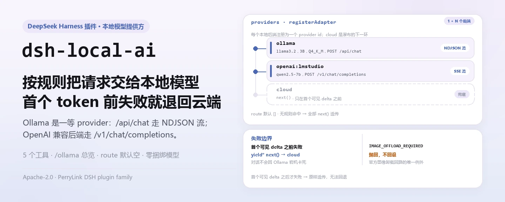
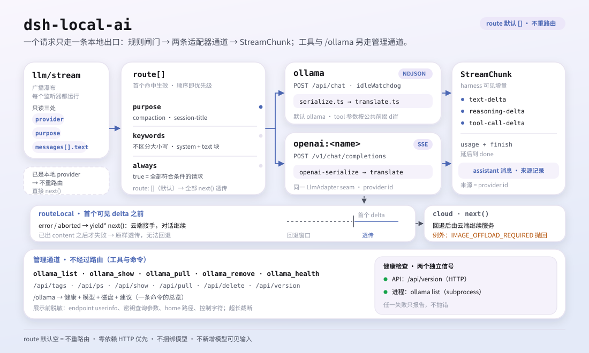

<div align="center">

<picture>
  <source media="(prefers-color-scheme: dark)" srcset="docs/assets/dsh-local-ai-hero-zh-dark.webp">
  
</picture>

# dsh-local-ai

**把 Ollama 接进 DeepSeek Harness，让本地模型成为可路由的一等提供方——请求按规则走本地，失败自动回退云端。**

无 UI 的纯 host 插件：发现、拉取、删除、查看本地模型，按任务类型或关键词分流，`/ollama` 一键状态总览，全部装在一个 bundle 里。

[安装](#三步上手) · [配置](#配置) · [FAQ](#faq) · [简体中文](README.md) · [English](README.en.md) · [Español](README.es.md) · [Português](README.pt.md) · [हिन्दी](README.hi.md)

[](LICENSE)
[](#兼容性)
[](https://www.npmjs.com/package/dsh-local-ai)
[](https://github.com/PerryLink/dsh-local-ai/actions/workflows/ci.yml)
[](#兼容性)

[](https://github.com/PerryLink/dsh-local-ai/stargazers)
[](https://www.npmjs.com/package/dsh-local-ai)
[](https://dshfind.com/plugins/PerryLink/dsh-local-ai?ref=badge)
[](https://securityscorecards.dev/viewer/?uri=github.com/PerryLink/dsh-local-ai)
[](https://dsh.market/)
[](https://gitee.com/perrylink/dsh-local-ai)

```sh
dsh plugin --profile <name> add dsh-local-ai
```

</div>

<sub>社区插件，与 DeepSeek 官方无关。唯一仓库：<https://github.com/PerryLink/dsh-local-ai>（Gitee 为镜像）。</sub>

## 它是什么

`dsh-local-ai` 把 Ollama 变成 DeepSeek Harness 的一等本地模型提供方：注册 `ollama` provider 路由，按任务类型或关键词把请求分流到本地模型，并在本地路由产出内容前失败时自动回退云端。五个工具负责模型的发现、拉取、删除、查看与健康检查，`/ollama` 给出一屏状态总览。全部走 Ollama 的 HTTP API（CLI 只用于进程探测），不捆绑任何模型文件，也不新增模型可见输入。

<picture>
  <source media="(prefers-color-scheme: dark)" srcset="docs/assets/dsh-local-ai-flow-v5-dark.svg">
  
</picture>

## 三步上手

1. **安装**（三选一）：

   ```sh
   # git 通道（最新 main；等价于 git+https://github.com/PerryLink/dsh-local-ai.git）
   dsh plugin --profile web add github:PerryLink/dsh-local-ai
   # npm 通道（已发布版本）
   dsh plugin --profile web add dsh-local-ai
   # tarball 通道：本仓库 pnpm pack 后
   dsh plugin --profile web add ./dsh-local-ai-<version>.tgz
   ```

   `prepare` 脚本只使用生产依赖构建。如果 pnpm 报 `ERR_PNPM_IGNORED_BUILDS`，在 `pnpm-workspace.yaml` 里加 `allowBuilds: { esbuild: true }` —— `dsh` CLI 会打印精确片段。

2. **最小路由配置**（`route` 在 `cordis.patch.yml` 里默认注释掉；先确保 Ollama 在 `http://127.0.0.1:11434` 运行）：

   ```yaml
   - insert:
       - id: dsh-local-ai
         name: dsh-local-ai
         config:
           route:
             - model: llama3.2
               keywords: ["confidential", "offline"]
   ```

3. **验证已生效**：

   ```sh
   dsh --profile web --dump-config | grep -A2 'id: dsh-local-ai'
   ```

   ```
   > /ollama
   ```

**卸载**：`dsh plugin --profile web remove dsh-local-ai`（或从 profile patch 删掉该行）。

<details>
<summary>从 DSH Desktop 市场安装</summary>

所有 PerryLink 插件均可在 DSH Desktop 内置市场中浏览：**市场 → 来源 → 添加来源 → 粘贴** `https://perrylink-dsh-catalog.perrylink.workers.dev/catalog-source.json` **→ 选中**。安装仍需通过市场的 npm 身份校验与你的确认。

</details>

## 核心能力

`dsh-local-ai` 让 Ollama 成为 DeepSeek Harness 的一等本地模型提供方：

- **发现与管理** —— `ollama_list`（已安装模型、运行中模型、磁盘占用）、`ollama_show`（参数尺寸、量化、上下文长度）、`ollama_pull`、`ollama_remove`。
- **健康检查** —— 进程存活（经 `ollama` CLI）与 API 响应（经 `/api/version`），作为两个独立信号报告。
- **官方适配器** —— 通过 `ctx.llm.registerAdapter`（`LlmAdapter`）注册 `ollama` provider 路由，支持配置模型映射与 temperature / max-tokens / stop 参数翻译。
- **OpenAI 兼容后端** —— LM Studio、vLLM、llama.cpp `--server` 各自经同一个 `LlmAdapter` seam 注册为 `openai:<name>` provider，复用一份 OpenAI `/v1/chat/completions` 适配器（纯文本路由）。
- **本地路由** —— `model_route` 规则按任务类型（`purpose`）、不区分大小写的关键词或 `always` 分流，本地路由在产出内容前失败时自动回退云端。
- **`/ollama` 命令** —— 一键状态总览：模型、磁盘占用、健康与建议。
- **零依赖、HTTP 优先** —— 一切走 Ollama 的 HTTP API（CLI 仅用于进程探测）；不捆绑模型文件。

```text
request (loop)
   │ llm/stream 瀑布
   ├─ 命中规则? ──▶ 路由到 ollama ──▶ Ollama /api/chat（NDJSON 流）
   │              └─▶ 路由到 openai:<name> ─▶ /v1/chat/completions（SSE）
   │                        └─ 先失败 ─▶ 回退云端（next()）
   └─ 未命中 ──▶ 云端提供方
tools ──▶ /api/tags · /api/ps · /api/show · /api/pull · /api/delete
health ──▶ /api/version（API）+ ollama list（进程）
```

### 命令与工具面

| 表面 | 类型 | 作用 |
|---|---|---|
| `ollama_list` | 工具 | 列出已安装模型、运行中模型与磁盘占用 |
| `ollama_show` | 工具 | 显示参数尺寸、量化、上下文长度、family、format |
| `ollama_pull` | 工具 | 拉取（下载）模型 |
| `ollama_remove` | 工具 | 删除模型 |
| `ollama_health` | 工具 | 进程存活 + API 响应 |
| `/ollama` | 命令 | 一键状态总览（模型 + 健康 + 建议） |

**消费**公开 host 服务 `ctx.llm`（`registerAdapter`）、`ctx.tools`、`ctx.subprocess`（CLI 探测）、`ctx.commands`。默认不短路 `llm/stream` —— 路由监听器在无规则命中时透传（`next()`）。

### 示例

以下为插件真实入口；安装后调用一个即可。

**详细示例** —— 工具 `ollama_list`，输入：

```json
{}
```

输出：

```text
1 local model(s), 100 B on disk
- llama3.2 (3B) — 100 B
```

*Observed from `plugins/dsh-local-ai/src/index.ts:83-90 (renderer); fixture/assertion at plugins/dsh-local-ai/test/index.spec.ts:31-35,68-82`*

**失败分支** —— 输入：

```text
{} (baseURL http://127.0.0.1:11434; nothing listening; no ollama binary on PATH)
```

输出：

```text
{
  "api": {
    "ok": false,
    "error": "connection refused"
  },
  "process": {
    "present": false,
    "error": "\"ollama\" not found: subprocess-local: command \"ollama\" was not found on PATH"
  }
}
```

*Observed from `plugins/dsh-local-ai/src/health.ts:52-66,79-92; plugins/dsh-local-ai/test/health.spec.ts:23-28,52-57`*

**简短示例**：`ollama_show` · `ollama_pull`

## 配置

所有可调参数都是 Schemastery `Config` 字段（可在 cordis.yml 中修改）。按 id 覆盖会替换整个 row —— 请重述你需要的每个键。`cordis.patch.yml` 对每个键都有行内注释。

最常用键：

| 键 | 默认值 | 含义 |
|---|---|---|
| `baseURL` | `http://127.0.0.1:11434` | Ollama HTTP API 基础 URL；会追加 `/api/*` 路径 |
| `requestTimeoutMs` | `30000` | 单次请求 HTTP 超时（毫秒） |
| `defaultContextWindow` | `8192` | 模型无精确值时的上下文容量 |
| `maxTokens` | `4096` | 模型无精确值时的单请求输出上限 |
| `vision` | `true` | 模型报告 vision 能力时声明并序列化图片支持；`false` 保持纯文本路由 |
| `models` | `[]` | Harness 可见名 → Ollama 模型映射 |
| `backends` | `[]` | OpenAI 兼容的本地后端（LM Studio / vLLM / llama.cpp） |
| `route` | `[]` | 本地模型路由规则（首个命中生效） |

<details>
<summary>完整配置表（27 个键）</summary>

| 键 | 默认值 | 含义 |
|---|---|---|
| `baseURL` | `http://127.0.0.1:11434` | Ollama HTTP API 基础 URL；会追加 `/api/*` 路径 |
| `requestTimeoutMs` | `30000` | 单次请求 HTTP 超时（毫秒） |
| `graceMs` | `15000` | 健康检查 CLI 探测的子进程终止宽限 |
| `defaultContextWindow` | `8192` | 模型无精确值时的上下文容量 |
| `maxTokens` | `4096` | 模型无精确值时的单请求输出上限 |
| `temperature` | *(none)* | 默认采样温度（0..2）；省略则用提供方默认值 |
| `vision` | `true` | 模型报告 vision 能力时声明并序列化图片支持；`false` 保持纯文本路由 |
| `visionCacheTtlMs` | `30000` | `/api/show` 能力探测的缓存毫秒数（`0` 关闭缓存；pull/remove 会使该模型失效） |
| `models` | `[]` | Harness 可见名 → Ollama 模型映射 |
| `models[].name` | *(required)* | Harness 可见模型名（`GenerateOptions.model`） |
| `models[].model` | `= name` | Ollama 模型 id |
| `models[].contextWindow` | *(none)* | 该模型的上下文容量 |
| `models[].maxTokens` | *(none)* | 该模型的输出上限 |
| `models[].temperature` | *(none)* | 该模型的采样温度 |
| `backends` | `[]` | OpenAI 兼容的本地后端（LM Studio / vLLM / llama.cpp） |
| `backends[].name` | *(required)* | 后端名；注册为 provider id `openai:<name>` |
| `backends[].baseURL` | *(required)* | 后端 base URL（含 `/v1`），如 `http://127.0.0.1:1234/v1` |
| `backends[].apiKey` | *(none)* | 可选 bearer API key（多数本地服务器留空） |
| `backends[].models` | `[]` | Harness 可见名 → 后端模型映射 |
| `backends[].maxTokens` | `4096` | 该后端无精确值时的输出上限 |
| `backends[].temperature` | *(none)* | 该后端的采样温度 |
| `route` | `[]` | 本地模型路由规则（首个命中生效） |
| `route[].model` | *(required)* | 目标本地模型名 |
| `route[].provider` | `ollama` | 目标 provider id：`ollama` 或 `openai:<name>` |
| `route[].purpose` | *(none)* | 任务类型匹配：`compaction` / `session-title` |
| `route[].keywords` | `[]` | 不区分大小写的请求关键词 |
| `route[].always` | `false` | 把所有符合条件的请求路由到此模型 |

</details>

profile patch 覆盖示例：

```yaml
- insert:
    - id: dsh-local-ai
      name: dsh-local-ai
      config:
        backends:
          - name: lmstudio
            baseURL: http://127.0.0.1:1234/v1
        route:
          - model: llama3.2
            keywords: ["confidential", "offline"]
          - model: qwen2.5-7b
            provider: openai:lmstudio
            always: true
```

## FAQ

<details>
<summary>Ollama 挂了或端点不通，会把对话搞崩吗？</summary>

不会。路由监听器在本地路由产出首个 token 前失败时回退云端（`next()`），所以一个宕掉的 Ollama 不会卡死对话；`/ollama` 总览是 best-effort，服务器宕机也不会抛错。**唯一例外**：带 `IMAGE_OFFLOAD_REQUIRED` 的失败会被重新抛出，不回退云端（见「安全边界」）；首个 token 之后才失败则原样透传，无法回退。

</details>

<details>
<summary>请求发到哪里？插件会存我的数据吗？</summary>

只向你在 `baseURL` / `backends[].baseURL` 配置的端点发起 `network:outbound` 请求。插件不读文件系统、不建存储、不存凭据；展示给模型或用户的模型列表、健康事实与错误消息都会先脱敏——去掉端点 userinfo 与密钥查询参数、剥离控制字符、限制长度。工具与命令结果由 harness 自身的 tool/command seam 记录。

</details>

<details>
<summary>默认会不会把请求偷偷改走本地？</summary>

不会。`route` 列表默认为空；只有显式规则命中，或你显式选择 `ollama` / `openai:<name>` provider 时，请求才会到达本地模型。

</details>

<details>
<summary>会和 dsh-routing-suite 这类插件抢 `llm/stream` 吗？</summary>

不会。`llm/stream` 是 Cordis 广播事件：每个监听器都会运行，任何一个都无法饿死其他监听器；本插件的监听器总是经 `next()` 委托，只有本地路由实际服务时才短路。它不提供任何服务键、不注册 `webServer` 前缀、不改写全局对象。逐条论证见「与其他 DSH 插件的互操作性」。

</details>

<details>
<summary>能跑视觉模型吗？</summary>

能，但取决于模型自报能力：`/api/show` capabilities 含 `vision` 的模型会声明 `inputModalities: ["text","image"]` 并在用户消息上携带 base64 图片载荷（可用 `vision: false` 退出）；纯文本模型仍拒绝图片内容（`UNSUPPORTED_CONTENT`）。

</details>

## 安全边界

- **默认不重路由** —— `route` 列表默认为空；请求只有通过显式规则或显式选择 `ollama` provider 才会到达本地模型。
- **展示前脱敏** —— 端点地址与本地路径在进入工具输出、`/ollama` 命令或错误消息前都会被脱敏。
- **零捆绑模型** —— 下载与存储是 Ollama 自己的事；包内不含任何模型。
- **失败响亮、失败可控** —— 非法配置导致挂载失败；本地路由在产出内容前失败会回退云端（`next()`），因此 Ollama 宕机不会卡死对话。**唯一例外**：带 `IMAGE_OFFLOAD_REQUIRED` 的失败会被重新抛出而不回退云端——该码是官方图像卸载回路在要求这条本地路由卸下保留图片，回退会跳过回路并把本应只在本地的请求静默发往远端提供方。
- **模型可见 ⟺ 已记录** —— 路由只改变由哪个提供方服务请求（assistant 消息会以 `ollama` 来源记录）；不凭空新增模型可见输入。

## 权限与数据

- **权限**：对您配置的 Ollama 端点使用 `network:outbound`；无原生代码、无文件系统访问、无存储。
- **数据**：展示给模型或用户的每个模型列表/详情、健康事实与错误消息在展示前都经过脱敏（去除端点 userinfo 与密钥查询参数、剥离控制字符、限制长度）。工具与命令结果由 harness 自身的 tool/command 机制记录。
- **凭据**：插件不存储也不读取任何凭据。它只向您配置的端点发起 HTTP 请求，外加本地 `ollama list` 进程探测。

## 已知限制

- **npm 0.2.0-rc.2** —— 针对 `@deepseek-ai/dsh@0.2.0-rc.2` 开发与测试；更新版本的 harness 基线预期可用，但由每月 compat workflow 验证。
- **模型声明 vision 时启用视觉** —— `/api/show` capabilities 含 `vision` 的模型声明 `inputModalities: ["text","image"]`，并在用户消息上携带 base64 图片载荷（可用 `vision: false` 退出）；纯文本模型仍拒绝图片内容（`UNSUPPORTED_CONTENT`）。
- **中途失败不回退** —— 本地路由一旦开始产出内容，之后的失败会透传（无法撤回）；只有首个 token 前的失败才回退云端。

## 与其他 DSH 插件的互操作性

已对照 **DSH `0.2.0-rc.2`**（本 README 面向的运行时）与 2026-10-05 实测的高星插件集验证。

本插件**不干扰**其他插件，包括广泛安装的高星插件：

- **无工具名冲突。** 所有工具都带命名空间，不占用任何已被内置工具或其他插件持有的裸名。
- **无服务键冲突。** 不提供任何服务键，因此不存在服务键冲突。
- **无 slot 冲突。** 不注册客户端 slot key，因此不参与 `shadows-shipped-ui` 座位争抢。
- **无 HTTP 路由冲突。** 不注册任何 `webServer` 前缀。
- **无 patch 层冲突。** 组合包 patch 只 `insert` 自己那一行，从不覆写内置行的 `config`。
- **无全局改写。** 不改原型、不改写 `process.env`、不替换全局 fetch dispatcher。

**共享事件监听器在构造上就不互相干扰。** 它用 `ctx.on()` 监听顺序敏感事件 `llm/stream` —— Cordis 的**广播**语义：每个监听器都会运行，任何一个都无法饿死其他监听器。**此处每个监听器都通过 `next()` 委托**，因此链条绝不会被短路；改写作用在 `next()` 产出的值上，而不是用它顶替返回：

- `llm/stream` — also used by `dsh-routing-suite` (7000★).

静态证据：`dsh-plugin-doctor` 的 K10–K13 在本仓全部为 `pass`。

## 兼容性

| 项目 | 状态 |
|---|---|
| Harness | DeepSeek Harness `dsh-v0.2.1-alpha.1`（2026-10-04 核验：三把 typecheck 尺子（已装包、CI、checkout）+ 142 项测试 + self-contained/artifacts 门；已适配 `0.1.7` 的内容块联合 —— 工具结果现为一等 `tool` 角色消息，旧日志里的 `tool-result` 包裹块仍可读取）。peer 范围接纳全部受支持线：`>=0.1.2-rc.1 <0.2.0 \|\| >=0.1.5-alpha.1 <0.2.0 \|\| >=0.1.6-0 <0.2.0 \|\| >=0.1.7-0 <0.2.0 \|\| >=0.2.0-0 <0.3.0 \|\| >=0.2.1-0 <0.3.0 \|\| >=0.2.2-0 <0.3.0`；dev/test 钉号 `0.2.0-rc.2`。 |
| Node | `^22.19.0 \|\| >=24.9.0` |
| 后端 | [Ollama](https://ollama.com)（本地 HTTP API + CLI 探测） |
| 模型 | 纯文本路由（`inputModalities: ['text']`）；支持工具调用与工具结果 |

## 生态与质量

- [Gitee 镜像](https://gitee.com/perrylink/dsh-local-ai)（同步镜像，以 GitHub 为准）
- [dshfind 插件页](https://dshfind.com/plugins/PerryLink/dsh-local-ai)（安装量与排名）
- [OpenSSF Scorecard 报告](https://securityscorecards.dev/viewer/?uri=github.com/PerryLink/dsh-local-ai)（由 [.github/workflows/scorecard.yml](.github/workflows/scorecard.yml) 驱动）
- [dsh-plugin-doctor 验证报告](https://github.com/PerryLink/dsh-plugin-doctor#verified-徽章)（K10–K13 全 `pass`）
- [DSH Market](https://dsh.market/)（已上架）
- **1024 商店渠道**：先 `npm i -g dsh1024`，再 `dsh1024 plugin --profile web add dsh-local-ai`（计入 [deepseek1024.com](https://deepseek1024.com) 安装排行）
- [生态实测知识库](https://perrylink.github.io/dsh-plugin-guide/)：插件开发指南 · 选型实测数据 · 维护取舍判据

## 开发

```sh
pnpm install        # node ^22.19 || >=24
pnpm run typecheck  # tsc: src + tests against the published 0.2.0-rc.2 types
pnpm run typecheck:ci  # strict tsc against published rc.2 types (skipLibCheck off)
pnpm test           # vitest: real Context/LlmRuntime/ToolRuntime/CommandRuntime/subprocess seams
pnpm run test:coverage  # coverage gate (90/80/90/90)
pnpm run build      # tsdown bundle + tsc declarations (lib/)
pnpm run verify:self-contained  # dependency specs resolve from the registry
pnpm run verify:artifacts       # built ESM face + bundle patch present
node scripts/check-readme-sync.mjs  # five-language README sync gate
node scripts/check-endpoints.mjs  # M3 endpoint-liveness probe (Ollama /api/version)
pnpm pack           # the published tarball
```

构建产物是 `lib/`（`pnpm run build` 由 tsdown 打包并生成 tsc 声明）。配图由 [`scripts/gen-readme-assets.py`](scripts/gen-readme-assets.py) 程序化生成（Python + Pillow），可重复执行。

Topics：`dsh`, `dsh-plugin`, `deepseek-harness`, `deepseek`, `cordis`, `ollama`, `local-llm`, `local-models`, `offline`, `privacy`, `model-routing`

## 家族与致谢

本项目是 [PerryLink](https://github.com/PerryLink) 维护的 DeepSeek Harness 插件家族成员（95 个，全部 Apache-2.0）。如果这个插件帮到了你，**给个 star**——它不解锁任何功能，但会让下一个人更容易找到它。

- [@PerryLink](https://github.com/PerryLink) —— 创建者与维护者：适配器、路由、工具、健康检查、脱敏与五语文档。
- [@LABEST-IA](https://github.com/LABEST-IA) —— 工具调用 CallId 修复（PR #2），以及工具调用槽位与视觉支持的报告（issue #1、#3、#5）。

<details>
<summary>展开全部插件</summary>

| 插件 | 状态 |
|---|---|
| **[dsh-aqua-input-check](https://github.com/PerryLink/dsh-aqua-input-check)** |  |
| **[dsh-archive-check](https://github.com/PerryLink/dsh-archive-check)** |  |
| **[dsh-auto-review](https://github.com/PerryLink/dsh-auto-review)** |  |
| **[dsh-autotier](https://github.com/PerryLink/dsh-autotier)** | 🧊 已冻结 — 见仓库 README |
| **[dsh-bid-ca-precheck](https://github.com/PerryLink/dsh-bid-ca-precheck)** |  |
| **[dsh-bid-qual-check](https://github.com/PerryLink/dsh-bid-qual-check)** |  |
| **[dsh-cert-mcp](https://github.com/PerryLink/dsh-cert-mcp)** | 🧊 已冻结 — 见仓库 README |
| **[dsh-checkpoint-rewind](https://github.com/PerryLink/dsh-checkpoint-rewind)** |  |
| **[dsh-click](https://github.com/PerryLink/dsh-click)** |  |
| **[dsh-composer-history](https://github.com/PerryLink/dsh-composer-history)** |  |
| **[dsh-contract-stance](https://github.com/PerryLink/dsh-contract-stance)** |  |
| **[dsh-customs-doc-check](https://github.com/PerryLink/dsh-customs-doc-check)** |  |
| **[dsh-data-quality](https://github.com/PerryLink/dsh-data-quality)** | 🧊 已冻结 — 见仓库 README |
| **[dsh-demurrage-ledger](https://github.com/PerryLink/dsh-demurrage-ledger)** |  |
| **[dsh-doublecheck](https://github.com/PerryLink/dsh-doublecheck)** |  |
| **[dsh-drill-script-check](https://github.com/PerryLink/dsh-drill-script-check)** |  |
| **[dsh-eia-guide-check](https://github.com/PerryLink/dsh-eia-guide-check)** |  |
| **[dsh-emergency-plan](https://github.com/PerryLink/dsh-emergency-plan)** |  |
| **[dsh-essay-rubric-check](https://github.com/PerryLink/dsh-essay-rubric-check)** |  |
| **[dsh-evidence-check](https://github.com/PerryLink/dsh-evidence-check)** |  |
| **[dsh-export-ctl-check](https://github.com/PerryLink/dsh-export-ctl-check)** |  |
| **[dsh-fast](https://github.com/PerryLink/dsh-fast)** |  |
| **[dsh-fmea-table-check](https://github.com/PerryLink/dsh-fmea-table-check)** |  |
| **[dsh-forecast-penalty](https://github.com/PerryLink/dsh-forecast-penalty)** |  |
| **[dsh-fund-research](https://github.com/PerryLink/dsh-fund-research)** |  |
| **[dsh-github](https://github.com/PerryLink/dsh-github)** |  |
| **[dsh-gongwen-flow-check](https://github.com/PerryLink/dsh-gongwen-flow-check)** |  |
| **[dsh-gongwen-word-check](https://github.com/PerryLink/dsh-gongwen-word-check)** |  |
| **[dsh-guard-plan-qc](https://github.com/PerryLink/dsh-guard-plan-qc)** |  |
| **[dsh-hazchem-check](https://github.com/PerryLink/dsh-hazchem-check)** |  |
| **[dsh-hazplan-check](https://github.com/PerryLink/dsh-hazplan-check)** |  |
| **[dsh-hidden-risk-map](https://github.com/PerryLink/dsh-hidden-risk-map)** |  |
| **[dsh-hs-classify](https://github.com/PerryLink/dsh-hs-classify)** |  |
| **[dsh-icd-rule-check](https://github.com/PerryLink/dsh-icd-rule-check)** |  |
| **[dsh-industry-research](https://github.com/PerryLink/dsh-industry-research)** |  |
| **[dsh-lawcite-adapter](https://github.com/PerryLink/dsh-lawcite-adapter)** |  |
| **[dsh-laya](https://github.com/PerryLink/dsh-laya)** |  |
| **[dsh-lc-doc-check](https://github.com/PerryLink/dsh-lc-doc-check)** |  |
| **[dsh-learning-gap-check](https://github.com/PerryLink/dsh-learning-gap-check)** |  |
| **[dsh-library](https://github.com/PerryLink/dsh-library)** |  |
| **[dsh-local-ai](https://github.com/PerryLink/dsh-local-ai)** |  |
| **[dsh-lsp-actions](https://github.com/PerryLink/dsh-lsp-actions)** |  |
| **[dsh-mask](https://github.com/PerryLink/dsh-mask)** |  |
| **[dsh-mcp-panel](https://github.com/PerryLink/dsh-mcp-panel)** |  |
| **[dsh-medrec-qc](https://github.com/PerryLink/dsh-medrec-qc)** |  |
| **[dsh-memento](https://github.com/PerryLink/dsh-memento)** | 🧊 已冻结 — 见仓库 README |
| **[dsh-nsfc-form-check](https://github.com/PerryLink/dsh-nsfc-form-check)** |  |
| **[dsh-nurse-record-check](https://github.com/PerryLink/dsh-nurse-record-check)** |  |
| **[dsh-observe](https://github.com/PerryLink/dsh-observe)** |  |
| **[dsh-origin-rvc-check](https://github.com/PerryLink/dsh-origin-rvc-check)** |  |
| **[dsh-ota-review-check](https://github.com/PerryLink/dsh-ota-review-check)** |  |
| **[dsh-output-styles](https://github.com/PerryLink/dsh-output-styles)** |  |
| **[dsh-paper-doc-adapter](https://github.com/PerryLink/dsh-paper-doc-adapter)** |  |
| **[dsh-permission-rules](https://github.com/PerryLink/dsh-permission-rules)** |  |
| **[dsh-permit-report-check](https://github.com/PerryLink/dsh-permit-report-check)** |  |
| **[dsh-pipeline-check](https://github.com/PerryLink/dsh-pipeline-check)** |  |
| **[dsh-pleading-draft](https://github.com/PerryLink/dsh-pleading-draft)** |  |
| **[dsh-plugin-doctor](https://github.com/PerryLink/dsh-plugin-doctor)** | 🚫 已退役（仓库已归档） |
| **[dsh-plugin-guide](https://github.com/PerryLink/dsh-plugin-guide)** |  |
| **[dsh-plugin-kit](https://github.com/PerryLink/dsh-plugin-kit)** | 🚫 已退役（仓库已归档） |
| **[dsh-plugin-upgrade](https://github.com/PerryLink/dsh-plugin-upgrade)** | 🚫 已退役（仓库已归档） |
| **[dsh-policy-brief-draft](https://github.com/PerryLink/dsh-policy-brief-draft)** |  |
| **[dsh-power-loss-split](https://github.com/PerryLink/dsh-power-loss-split)** |  |
| **[dsh-power-ticket-check](https://github.com/PerryLink/dsh-power-ticket-check)** |  |
| **[dsh-ppap-check](https://github.com/PerryLink/dsh-ppap-check)** |  |
| **[dsh-protest-deadline](https://github.com/PerryLink/dsh-protest-deadline)** |  |
| **[dsh-railway-window](https://github.com/PerryLink/dsh-railway-window)** |  |
| **[dsh-repair-order-qc](https://github.com/PerryLink/dsh-repair-order-qc)** |  |
| **[dsh-research-report](https://github.com/PerryLink/dsh-research-report)** |  |
| **[dsh-review-reply-check](https://github.com/PerryLink/dsh-review-reply-check)** |  |
| **[dsh-rulefile-check](https://github.com/PerryLink/dsh-rulefile-check)** |  |
| **[dsh-safety-brief-check](https://github.com/PerryLink/dsh-safety-brief-check)** |  |
| **[dsh-score](https://github.com/PerryLink/dsh-score)** | 🧊 已冻结 — 见仓库 README |
| **[dsh-session-sync](https://github.com/PerryLink/dsh-session-sync)** |  |
| **[dsh-site-log-check](https://github.com/PerryLink/dsh-site-log-check)** |  |
| **[dsh-skill-pack-security](https://github.com/PerryLink/dsh-skill-pack-security)** |  |
| **[dsh-soe-decision-check](https://github.com/PerryLink/dsh-soe-decision-check)** |  |
| **[dsh-soilwater-check](https://github.com/PerryLink/dsh-soilwater-check)** |  |
| **[dsh-sop-sync-check](https://github.com/PerryLink/dsh-sop-sync-check)** |  |
| **[dsh-spc-gbt-adapter](https://github.com/PerryLink/dsh-spc-gbt-adapter)** |  |
| **[dsh-talk](https://github.com/PerryLink/dsh-talk)** |  |
| **[dsh-tender-extract](https://github.com/PerryLink/dsh-tender-extract)** |  |
| **[dsh-tender-matrix](https://github.com/PerryLink/dsh-tender-matrix)** |  |
| **[dsh-test-drive](https://github.com/PerryLink/dsh-test-drive)** |  |
| **[dsh-ticktick](https://github.com/PerryLink/dsh-ticktick)** | 🚫 已退役（仓库已归档） |
| **[dsh-translate](https://github.com/PerryLink/dsh-translate)** |  |
| **[dsh-warranty-calc](https://github.com/PerryLink/dsh-warranty-calc)** |  |
| **[dsh-budget](https://github.com/PerryLink/dsh-budget)** | 🧊 已冻结 — 见仓库 README |
| **[dsh-claude-move](https://github.com/PerryLink/dsh-claude-move)** | 🧊 已冻结 — 见仓库 README |
| **[dsh-defend](https://github.com/PerryLink/dsh-defend)** | 🧊 已冻结 — 见仓库 README |
| **[dsh-draw](https://github.com/PerryLink/dsh-draw)** | 🧊 已冻结 — 见仓库 README |
| **[dsh-reach](https://github.com/PerryLink/dsh-reach)** | 🧊 已冻结 — 见仓库 README |
| **[dsh-background-agents](https://github.com/PerryLink/dsh-background-agents)** | 🚫 已退役（仓库已归档） |
| **[dsh-session-pin](https://github.com/PerryLink/dsh-session-pin)** | 🚫 已退役（仓库已归档） |
| **[dsh-team-rooms](https://github.com/PerryLink/dsh-team-rooms)** | 🚫 已退役（仓库已归档） |

</details>

## License

[LICENSE](LICENSE)（Apache License 2.0）© 2026 dsh-local-ai contributors

<p align="center"><sub>Apache-2.0 · 社区插件，与 DeepSeek 无关。</sub></p>

<p align="center"><sub>工具链：<a href="https://github.com/PerryLink/dsh-plugin-guide">dsh-plugin-guide</a> · <a href="https://github.com/PerryLink/dsh-standards">dsh-standards</a> · <a href="https://github.com/PerryLink/dsh-plugin-start">dsh-plugin-start</a></sub></p>
