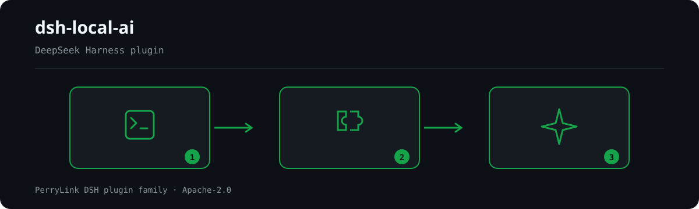

<div align="center">

# 🤖 dsh-local-ai
- **1024 store channel**: `npm i -g dsh1024` once, then `dsh1024 plugin --profile web add dsh-local-ai` (counts toward the [deepseek1024.com](https://deepseek1024.com) install ranking).
[](https://gitee.com/perrylink/dsh-local-ai)
[](https://dshfind.com/plugins/PerryLink/dsh-local-ai?ref=badge)

**Local-model (Ollama) integration for DeepSeek Harness.**

*Discover, pull, remove, and inspect local models, route requests to them by task type or keyword with automatic fallback to the cloud, and get a one-shot status overview via `/ollama`.*

> **Official repository.** This is the only official repository of dsh-local-ai, maintained by PerryLink. Same-name repositories under other accounts are not affiliated.

[](LICENSE)
[](https://github.com/topics/dsh-plugin)
[](https://dsh.market/)
[](https://github.com/PerryLink/dsh-plugin-doctor#verified-徽章)
[](#)
[](https://github.com/PerryLink/dsh-local-ai/actions)
[](https://github.com/PerryLink/dsh-local-ai/releases)
[](https://www.npmjs.com/package/dsh-local-ai)
[](https://www.npmjs.com/package/dsh-local-ai)

[English](README.md) · [简体中文](README-zh.md) · [Español](README-es.md) · [Português](README-pt.md) · [हिन्दी](README-hi.md)

```sh
dsh plugin --profile <name> add dsh-local-ai
```


</div>

---

**📖 Ecosystem knowledge base** — measured data, not marketing: [plugin development guide · plugin-selection data · maintenance criteria](https://perrylink.github.io/dsh-plugin-guide/).

<!-- star-cta -->
## Install & uninstall

- **git channel** (latest `main`): `dsh plugin --profile web add github:PerryLink/dsh-local-ai` — the `prepare` script builds with production dependencies only.
- **npm channel** (published releases): `dsh plugin --profile web add dsh-local-ai`.
- **tarball channel**: `pnpm pack` in this repo, then `dsh plugin --profile web add ./dsh-local-ai-<version>.tgz`.
- **uninstall**: `dsh plugin --profile web remove dsh-local-ai` (or remove the row from the profile patch).

> If pnpm reports `ERR_PNPM_IGNORED_BUILDS` for this package, add `allowBuilds: { esbuild: true }` to your `pnpm-workspace.yaml` — the `dsh` CLI prints the exact snippet.

## ⭐ 如果它帮到了你

这个插件是 [DSH 插件家族](https://github.com/PerryLink)的一员（95 个，全部 Apache-2.0）。如果你在用，**给个 star** —— 它不会解锁任何功能，但会让下一个人在搜索里更容易找到它。

*English:* part of a 95 plugin family for DeepSeek Harness. If it is useful, **a star helps the next person find it** — nothing is gated behind it.


## What is dsh-local-ai?

Local-model (Ollama) integration for DeepSeek Harness.

Discover, pull, remove, and inspect local models, route requests to them by task type or keyword with automatic fallback to the cloud, and get a one-shot status overview via `/ollama`.



*Workflow overview: call → plugin → result. The examples below use the real command surface.*


## Compatibility

| Surface | Status |
|---|---|
| Harness | DeepSeek Harness `dsh-v0.2.1-alpha.1` (verified 2026-10-04: three typecheck rulers (installed, CI, checkout) + 142 tests + self-contained/artifacts gates; the `0.1.7` content-block union is adapted — a tool result is a first-class `tool`-role message, and a pre-`0.1.7` `tool-result` wrapper is still read for old logs). The peer range admits every supported line: `>=0.1.2-rc.1 <0.2.0 \|\| >=0.1.5-alpha.1 <0.2.0 \|\| >=0.1.6-0 <0.2.0 \|\| >=0.1.7-0 <0.2.0 \|\| >=0.2.0-0 <0.3.0 \|\| >=0.2.1-0 <0.3.0`; dev/test pins are `0.2.0-rc.2`. |
| Node | `^22.19.0 \|\| >=24.0.0` |
| Backend | [Ollama](https://ollama.com) (local HTTP API + CLI probe) |
| Model | Text-only route (`inputModalities: ['text']`); tool calls and tool results are supported |

## What you get

`dsh-local-ai` makes Ollama a first-class local provider in DeepSeek Harness:

- **Discovery & management** — `ollama_list` (installed models, running models, disk usage), `ollama_show` (parameter size, quantization, context length), `ollama_pull`, and `ollama_remove`.
- **Health check** — process liveness (via the `ollama` CLI) and API responsiveness (via `/api/version`), reported as two independent signals.
- **Official adapter** — the `ollama` provider route is registered through `ctx.llm.registerAdapter` (`LlmAdapter`), with configurable model mapping and temperature / max-tokens / stop translation.
- **OpenAI-compatible backends** — LM Studio, vLLM, and llama.cpp `--server` each register as their own `openai:<name>` provider through the same `LlmAdapter` seam, reusing one OpenAI `/v1/chat/completions` adapter (text-only route).
- **Local routing** — `model_route` rules route requests to a local model by task type (`purpose`), case-insensitive keyword, or `always`, with automatic fallback to the cloud when the local route fails before producing content.
- **`/ollama` command** — a one-shot status overview: models, disk usage, health, and suggestions.
- **Zero dependencies, HTTP first** — everything talks to Ollama's HTTP API (the CLI is used only for the process probe); no model files are bundled.

```text
request (loop)
   │ llm/stream waterfall
   ├─ rule matches? ──▶ route to ollama ──▶ Ollama /api/chat (NDJSON stream)
   │              └─▶ route to openai:<name> ─▶ /v1/chat/completions (SSE)
   │                        └─ fails first ─▶ fall back to cloud (next())
   └─ no match ──▶ cloud provider
tools ──▶ /api/tags · /api/ps · /api/show · /api/pull · /api/delete
health ──▶ /api/version (API) + ollama list (process)
```

## Quick start

```sh
dsh plugin --profile web add github:PerryLink/dsh-local-ai
```

```sh
# 1. install the bundle into your profile
dsh plugin --profile web add github:PerryLink/dsh-local-ai

# or from npm (published releases)
dsh plugin --profile web add dsh-local-ai

# 2. configure routing in your profile patch (cordis.yml) and restart
dsh --profile web
```

Minimal routing configuration (the rule ships commented out in `cordis.patch.yml`):

```yaml
- insert:
    - id: dsh-local-ai
      name: dsh-local-ai
      config:
        route:
          - model: llama3.2
            keywords: ["confidential", "offline"]
```

Then verify the row mounts:

```sh
dsh --profile web --dump-config | grep -A2 'id: dsh-local-ai'
```

### Examples

These are the plugin's real entry points; install once, then call one.

#### Detailed example

**Command**

~~~sh
ollama_list
~~~

**Input**

~~~json
{}
~~~

**Output**

~~~text
1 local model(s), 100 B on disk
- llama3.2 (3B) — 100 B
~~~

*Observed from `plugins/dsh-local-ai/src/index.ts:83-90 (renderer); fixture/assertion at plugins/dsh-local-ai/test/index.spec.ts:31-35,68-82`*

#### Failure branch

**Input**

~~~text
{} (baseURL http://127.0.0.1:11434; nothing listening; no ollama binary on PATH)
~~~

**Output**

~~~text
{
  "api": {
    "ok": false,
    "error": "connection refused"
  },
  "process": {
    "present": false,
    "error": "\"ollama\" not found: subprocess-local: command \"ollama\" was not found on PATH"
  }
}
~~~

*Observed from `plugins/dsh-local-ai/src/health.ts:52-66,79-92; plugins/dsh-local-ai/test/health.spec.ts:23-28,52-57`*

#### Brief examples

- `ollama_show`
- `ollama_pull`

## Configuration

All tunables are Schemastery `Config` fields (changeable from cordis.yml). An id-targeted override replaces the whole row — restate every key you need. `cordis.patch.yml` documents each key inline.

| Key | Default | Meaning |
|---|---|---|
| `baseURL` | `http://127.0.0.1:11434` | Ollama HTTP API base URL; `/api/*` paths are appended |
| `requestTimeoutMs` | `30000` | Per-request HTTP timeout (milliseconds) |
| `graceMs` | `15000` | Subprocess terminate grace for the health-check CLI probe |
| `defaultContextWindow` | `8192` | Context capacity used when a model has no exact value |
| `maxTokens` | `4096` | Per-request output cap used when a model has no exact value |
| `temperature` | *(none)* | Default sampling temperature (0..2); omitted leaves the provider default |
| `vision` | `true` | Declare and serialize image support when the model reports vision; `false` keeps the route text-only |
| `visionCacheTtlMs` | `30000` | Milliseconds a `/api/show` capability probe stays cached (`0` disables caching; a pull or remove invalidates that model) |
| `models` | `[]` | Harness-visible → Ollama model mappings |
| `models[].name` | *(required)* | Harness-visible model name (`GenerateOptions.model`) |
| `models[].model` | `= name` | Ollama model id |
| `models[].contextWindow` | *(none)* | Per-model context capacity |
| `models[].maxTokens` | *(none)* | Per-model output cap |
| `models[].temperature` | *(none)* | Per-model sampling temperature |
| `backends` | `[]` | OpenAI-compatible local backends (LM Studio / vLLM / llama.cpp) |
| `backends[].name` | *(required)* | Backend name; registers provider id `openai:<name>` |
| `backends[].baseURL` | *(required)* | Backend base URL including `/v1`, e.g. `http://127.0.0.1:1234/v1` |
| `backends[].apiKey` | *(none)* | Optional bearer API key (most local servers leave it empty) |
| `backends[].models` | `[]` | Harness-visible → backend model mappings |
| `backends[].maxTokens` | `4096` | Per-backend output cap used when a model has no exact value |
| `backends[].temperature` | *(none)* | Per-backend sampling temperature |
| `route` | `[]` | Local-model routing rules (first match wins) |
| `route[].model` | *(required)* | Target local model name |
| `route[].provider` | `ollama` | Target provider id: `ollama` or `openai:<name>` |
| `route[].purpose` | *(none)* | Task type match: `compaction` / `session-title` |
| `route[].keywords` | `[]` | Case-insensitive request keywords |
| `route[].always` | `false` | Route every eligible request to this model |

## Tools & surfaces

| Surface | Kind | What it does |
|---|---|---|
| `ollama_list` | tool | List installed models, running models, and disk usage |
| `ollama_show` | tool | Show parameter size, quantization, context length, family, format |
| `ollama_pull` | tool | Pull (download) a model |
| `ollama_remove` | tool | Remove a model |
| `ollama_health` | tool | Process liveness + API responsiveness |
| `/ollama` | command | One-shot status overview (models + health + suggestions) |

**Consumes** the public host services `ctx.llm` (`registerAdapter`), `ctx.tools`, `ctx.subprocess` (CLI probe), and `ctx.commands`. It registers no `llm/stream` short-circuit by default — the routing listener passes through (`next()`) unless a rule matches.

## Permissions & data

- **Permissions**: `network:outbound` to the Ollama endpoint you configure; no native code, no filesystem access, no storage.
- **Data**: every model list/detail, health fact, and error message shown to the model or the user is sanitized (endpoint userinfo and secret query params dropped, control characters stripped, lengths bounded) before display. Tool and command results are logged by the harness's own tool/command seams.
- **Credentials**: the plugin stores and reads no credentials. It only issues HTTP requests to the endpoint you configure, plus the local `ollama list` process probe.

## Security boundaries

- **No re-routing by default** — the `route` list is empty unless you opt in; a request reaches a local model only through an explicit rule or an explicit `ollama` provider selection.
- **Sanitize before display** — endpoint addresses and local paths are sanitized before they reach tool output, the `/ollama` command, or error messages.
- **Zero bundled models** — downloads and storage are Ollama's own responsibility; nothing is shipped in the package.
- **Failure loud, failure contained** — invalid config fails the mount; a local route that fails before producing content falls back to the cloud (`next()`), so a down Ollama never bricks a conversation. **One carve-out:** a failure carrying `IMAGE_OFFLOAD_REQUIRED` is rethrown instead of retried on the cloud — that code is the official offload circuit asking this same local route to drop retained images, and falling back would skip the circuit while silently sending a local-only request to a remote provider.
- **Model-visible ⟺ logged** — routing only changes which provider serves a request (the assistant message is logged with its `ollama` provenance); no new model-visible input is invented.

## Known limitations

- **npm 0.2.0-rc.2** — developed and tested against `@deepseek-ai/dsh@0.2.0-rc.2`; newer harness baselines are expected to work but are verified by the monthly compat workflow.
- **Vision when the model reports it** — models whose `/api/show` capabilities include `vision` declare `inputModalities: ["text","image"]` and carry base64 image payloads on user messages (opt out with `vision: false`); text-only models still reject image content (`UNSUPPORTED_CONTENT`).
- **Mid-stream fallback** — once a local route has started producing content, a later failure is forwarded (not retracted); only a failure before the first token falls back to the cloud.

## Development

```sh
pnpm install        # node ^22.19 || >=24
pnpm run typecheck  # tsc: src + tests against the published 0.2.0-rc.2 types
pnpm run typecheck:ci  # strict tsc against published rc.2 types (skipLibCheck off)
pnpm test           # vitest: real Context/LlmRuntime/ToolRuntime/CommandRuntime/subprocess seams
pnpm run test:coverage  # coverage gate (90/80/90/90)
pnpm run build      # tsdown bundle + tsc declarations (lib/)
pnpm run verify:self-contained  # dependency specs resolve from the registry
pnpm run verify:artifacts       # built ESM face + bundle patch present
node scripts/check-readme-sync.mjs  # five-language README sync gate
node scripts/check-endpoints.mjs  # M3 endpoint-liveness probe (Ollama /api/version)
pnpm pack           # the published tarball
```

## Interoperability with other DSH plugins

Verified against **DSH `0.2.0-rc.2`** (the runtime this README ships for) and the high-star plugin set surveyed on 2026-10-05.

This plugin **does not interfere** with other plugins, including the widely installed high-star ones:

- **No tool-name collision.** Every tool is namespaced; no bare name owned by a shipped tool or another plugin is registered.
- **No service-key collision.** It provides no service key at all, so it cannot collide on one.
- **No slot collision.** It registers no client slot key, so it cannot contend for a `shadows-shipped-ui` seat.
- **No HTTP route collision.** It registers no `webServer` prefix.
- **No patch-layer collision.** The bundle patch only `insert`s its own row; it never overrides a built-in row's `config`.
- **No global mutation.** It does not patch prototypes, rewrite `process.env`, or replace the global fetch dispatcher.

**Shared event listeners are non-interfering by construction.** It observes the ordering-sensitive event `llm/stream` with `ctx.on()` — Cordis's broadcast registration, where every listener runs and none can starve another. **Every listener here delegates through `next()`**, so the chain is never short-circuited, and a mutation is applied to the value `next()` produced rather than returned in its place:
  - `llm/stream` — also used by `dsh-routing-suite` (7000★).

Static evidence: `dsh-plugin-doctor` K10–K13 report `pass` for every check on this repository.

## Topics

`dsh`, `dsh-plugin`, `deepseek-harness`, `deepseek`, `cordis`, `ollama`, `local-llm`, `local-models`, `offline`, `privacy`, `model-routing`

## Contributors

- [@PerryLink](https://github.com/PerryLink) — creator and maintainer: adapter, routing, tools, health check, sanitization, and the five-language docs.
- [@LABEST-IA](https://github.com/LABEST-IA) — tool-call CallId fix (PR #2), and the tool-call slot and vision-support reports (issues #1, #3, #5).

## PerryLink DSH Plugin Family

This project is part of the DeepSeek Harness plugin family from [PerryLink](https://github.com/PerryLink). The roster stays collapsed below so every README keeps a short first screen; expand it to see every row and its status.

<details>
<summary>Expand all plugins</summary>

| Plugin | Status |
|---|---|
| **[dsh-aqua-input-check](https://github.com/PerryLink/dsh-aqua-input-check)** |  |
| **[dsh-archive-check](https://github.com/PerryLink/dsh-archive-check)** |  |
| **[dsh-auto-review](https://github.com/PerryLink/dsh-auto-review)** |  |
| **[dsh-autotier](https://github.com/PerryLink/dsh-autotier)** |  |
| **[dsh-bid-ca-precheck](https://github.com/PerryLink/dsh-bid-ca-precheck)** |  |
| **[dsh-bid-qual-check](https://github.com/PerryLink/dsh-bid-qual-check)** |  |
| **[dsh-cert-mcp](https://github.com/PerryLink/dsh-cert-mcp)** |  |
| **[dsh-checkpoint-rewind](https://github.com/PerryLink/dsh-checkpoint-rewind)** |  |
| **[dsh-click](https://github.com/PerryLink/dsh-click)** |  |
| **[dsh-composer-history](https://github.com/PerryLink/dsh-composer-history)** |  |
| **[dsh-contract-stance](https://github.com/PerryLink/dsh-contract-stance)** |  |
| **[dsh-customs-doc-check](https://github.com/PerryLink/dsh-customs-doc-check)** |  |
| **[dsh-data-quality](https://github.com/PerryLink/dsh-data-quality)** |  |
| **[dsh-demurrage-ledger](https://github.com/PerryLink/dsh-demurrage-ledger)** |  |
| **[dsh-doublecheck](https://github.com/PerryLink/dsh-doublecheck)** |  |
| **[dsh-drill-script-check](https://github.com/PerryLink/dsh-drill-script-check)** |  |
| **[dsh-eia-guide-check](https://github.com/PerryLink/dsh-eia-guide-check)** |  |
| **[dsh-emergency-plan](https://github.com/PerryLink/dsh-emergency-plan)** |  |
| **[dsh-essay-rubric-check](https://github.com/PerryLink/dsh-essay-rubric-check)** |  |
| **[dsh-evidence-check](https://github.com/PerryLink/dsh-evidence-check)** |  |
| **[dsh-export-ctl-check](https://github.com/PerryLink/dsh-export-ctl-check)** |  |
| **[dsh-fast](https://github.com/PerryLink/dsh-fast)** |  |
| **[dsh-fmea-table-check](https://github.com/PerryLink/dsh-fmea-table-check)** |  |
| **[dsh-forecast-penalty](https://github.com/PerryLink/dsh-forecast-penalty)** |  |
| **[dsh-fund-research](https://github.com/PerryLink/dsh-fund-research)** |  |
| **[dsh-github](https://github.com/PerryLink/dsh-github)** |  |
| **[dsh-gongwen-flow-check](https://github.com/PerryLink/dsh-gongwen-flow-check)** |  |
| **[dsh-gongwen-word-check](https://github.com/PerryLink/dsh-gongwen-word-check)** |  |
| **[dsh-guard-plan-qc](https://github.com/PerryLink/dsh-guard-plan-qc)** |  |
| **[dsh-hazchem-check](https://github.com/PerryLink/dsh-hazchem-check)** |  |
| **[dsh-hazplan-check](https://github.com/PerryLink/dsh-hazplan-check)** |  |
| **[dsh-hidden-risk-map](https://github.com/PerryLink/dsh-hidden-risk-map)** |  |
| **[dsh-hs-classify](https://github.com/PerryLink/dsh-hs-classify)** |  |
| **[dsh-icd-rule-check](https://github.com/PerryLink/dsh-icd-rule-check)** |  |
| **[dsh-industry-research](https://github.com/PerryLink/dsh-industry-research)** |  |
| **[dsh-lawcite-adapter](https://github.com/PerryLink/dsh-lawcite-adapter)** |  |
| **[dsh-laya](https://github.com/PerryLink/dsh-laya)** |  |
| **[dsh-lc-doc-check](https://github.com/PerryLink/dsh-lc-doc-check)** |  |
| **[dsh-learning-gap-check](https://github.com/PerryLink/dsh-learning-gap-check)** |  |
| **[dsh-library](https://github.com/PerryLink/dsh-library)** |  |
| **[dsh-local-ai](https://github.com/PerryLink/dsh-local-ai)** |  |
| **[dsh-lsp-actions](https://github.com/PerryLink/dsh-lsp-actions)** |  |
| **[dsh-mask](https://github.com/PerryLink/dsh-mask)** |  |
| **[dsh-mcp-panel](https://github.com/PerryLink/dsh-mcp-panel)** |  |
| **[dsh-medrec-qc](https://github.com/PerryLink/dsh-medrec-qc)** |  |
| **[dsh-memento](https://github.com/PerryLink/dsh-memento)** |  |
| **[dsh-nsfc-form-check](https://github.com/PerryLink/dsh-nsfc-form-check)** |  |
| **[dsh-nurse-record-check](https://github.com/PerryLink/dsh-nurse-record-check)** |  |
| **[dsh-observe](https://github.com/PerryLink/dsh-observe)** |  |
| **[dsh-origin-rvc-check](https://github.com/PerryLink/dsh-origin-rvc-check)** |  |
| **[dsh-ota-review-check](https://github.com/PerryLink/dsh-ota-review-check)** |  |
| **[dsh-output-styles](https://github.com/PerryLink/dsh-output-styles)** |  |
| **[dsh-paper-doc-adapter](https://github.com/PerryLink/dsh-paper-doc-adapter)** |  |
| **[dsh-permission-rules](https://github.com/PerryLink/dsh-permission-rules)** |  |
| **[dsh-permit-report-check](https://github.com/PerryLink/dsh-permit-report-check)** |  |
| **[dsh-pipeline-check](https://github.com/PerryLink/dsh-pipeline-check)** |  |
| **[dsh-pleading-draft](https://github.com/PerryLink/dsh-pleading-draft)** |  |
| **[dsh-plugin-doctor](https://github.com/PerryLink/dsh-plugin-doctor)** |  |
| **[dsh-plugin-guide](https://github.com/PerryLink/dsh-plugin-guide)** |  |
| **[dsh-plugin-kit](https://github.com/PerryLink/dsh-plugin-kit)** |  |
| **[dsh-plugin-upgrade](https://github.com/PerryLink/dsh-plugin-upgrade)** |  |
| **[dsh-policy-brief-draft](https://github.com/PerryLink/dsh-policy-brief-draft)** |  |
| **[dsh-power-loss-split](https://github.com/PerryLink/dsh-power-loss-split)** |  |
| **[dsh-power-ticket-check](https://github.com/PerryLink/dsh-power-ticket-check)** |  |
| **[dsh-ppap-check](https://github.com/PerryLink/dsh-ppap-check)** |  |
| **[dsh-protest-deadline](https://github.com/PerryLink/dsh-protest-deadline)** |  |
| **[dsh-railway-window](https://github.com/PerryLink/dsh-railway-window)** |  |
| **[dsh-repair-order-qc](https://github.com/PerryLink/dsh-repair-order-qc)** |  |
| **[dsh-research-report](https://github.com/PerryLink/dsh-research-report)** |  |
| **[dsh-review-reply-check](https://github.com/PerryLink/dsh-review-reply-check)** |  |
| **[dsh-rulefile-check](https://github.com/PerryLink/dsh-rulefile-check)** |  |
| **[dsh-safety-brief-check](https://github.com/PerryLink/dsh-safety-brief-check)** |  |
| **[dsh-score](https://github.com/PerryLink/dsh-score)** |  |
| **[dsh-session-sync](https://github.com/PerryLink/dsh-session-sync)** |  |
| **[dsh-site-log-check](https://github.com/PerryLink/dsh-site-log-check)** |  |
| **[dsh-skill-pack-security](https://github.com/PerryLink/dsh-skill-pack-security)** |  |
| **[dsh-soe-decision-check](https://github.com/PerryLink/dsh-soe-decision-check)** |  |
| **[dsh-soilwater-check](https://github.com/PerryLink/dsh-soilwater-check)** |  |
| **[dsh-sop-sync-check](https://github.com/PerryLink/dsh-sop-sync-check)** |  |
| **[dsh-spc-gbt-adapter](https://github.com/PerryLink/dsh-spc-gbt-adapter)** |  |
| **[dsh-talk](https://github.com/PerryLink/dsh-talk)** |  |
| **[dsh-tender-extract](https://github.com/PerryLink/dsh-tender-extract)** |  |
| **[dsh-tender-matrix](https://github.com/PerryLink/dsh-tender-matrix)** |  |
| **[dsh-test-drive](https://github.com/PerryLink/dsh-test-drive)** |  |
| **[dsh-ticktick](https://github.com/PerryLink/dsh-ticktick)** |  |
| **[dsh-translate](https://github.com/PerryLink/dsh-translate)** |  |
| **[dsh-warranty-calc](https://github.com/PerryLink/dsh-warranty-calc)** |  |
| **[dsh-budget](https://github.com/PerryLink/dsh-budget)** | 🧊 FROZEN — see the repo README |
| **[dsh-claude-move](https://github.com/PerryLink/dsh-claude-move)** | 🧊 FROZEN — see the repo README |
| **[dsh-defend](https://github.com/PerryLink/dsh-defend)** | 🧊 FROZEN — see the repo README |
| **[dsh-draw](https://github.com/PerryLink/dsh-draw)** | 🧊 FROZEN — see the repo README |
| **[dsh-reach](https://github.com/PerryLink/dsh-reach)** | 🧊 FROZEN — see the repo README |
| **[dsh-background-agents](https://github.com/PerryLink/dsh-background-agents)** | 🚫 RETIRED — see the repo README |
| **[dsh-session-pin](https://github.com/PerryLink/dsh-session-pin)** | 🚫 RETIRED — see the repo README |
| **[dsh-team-rooms](https://github.com/PerryLink/dsh-team-rooms)** | 🚫 RETIRED — see the repo README |

</details>

## License

[Apache License 2.0](LICENSE) © 2026 dsh-local-ai contributors
