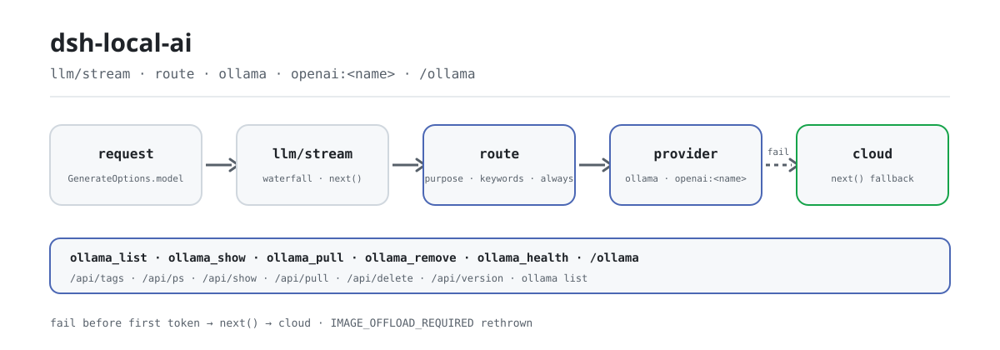

<div align="center">

<picture>
  <source media="(prefers-color-scheme: dark)" srcset="docs/assets/dsh-local-ai-flow-dark.svg">
  
</picture>

# dsh-local-ai

**Conecte o Ollama ao DeepSeek Harness e transforme modelos locais em um provedor de primeira classe roteável: as requisições vão para o local por regra e voltam para a nuvem quando falham.**

Um plugin headless puramente host-side: descubra, baixe, remova e inspecione modelos locais, roteie por tipo de tarefa ou palavra-chave e obtenha um resumo de status com `/ollama`, tudo em um único bundle.

[Instalar](#instalação-em-três-passos) · [Configuração](#configuração) · [FAQ](#faq) · [简体中文](README.md) · [English](README.en.md) · [Español](README.es.md) · [Português](README.pt.md) · [हिन्दी](README.hi.md)

[](LICENSE)
[](#compatibilidade)
[](https://www.npmjs.com/package/dsh-local-ai)
[](https://github.com/PerryLink/dsh-local-ai/actions/workflows/ci.yml)
[](#compatibilidade)

[](https://github.com/PerryLink/dsh-local-ai/stargazers)
[](https://www.npmjs.com/package/dsh-local-ai)
[](https://dshfind.com/plugins/PerryLink/dsh-local-ai?ref=badge)
[](https://securityscorecards.dev/viewer/?uri=github.com/PerryLink/dsh-local-ai)
[](https://dsh.market/)
[](https://gitee.com/perrylink/dsh-local-ai)

```sh
dsh plugin --profile <name> add dsh-local-ai
```

</div>

<sub>Plugin da comunidade, sem afiliação com a DeepSeek. Repositório canônico: <https://github.com/PerryLink/dsh-local-ai> (o Gitee é um espelho).</sub>

## O que é

`dsh-local-ai` transforma o Ollama em um provedor local de primeira classe dentro do DeepSeek Harness: registra a rota do provedor `ollama`, roteia requisições para modelos locais por tipo de tarefa ou palavra-chave e volta para a nuvem automaticamente quando uma rota local falha antes de produzir conteúdo. Cinco ferramentas cobrem descoberta, download, remoção, inspeção e saúde dos modelos, e `/ollama` entrega um resumo de status em uma tela. Tudo fala com a API HTTP do Ollama (a CLI só é usada para sondar o processo); nenhum arquivo de modelo é empacotado e nenhuma entrada nova visível ao modelo é inventada.

## Instalação em três passos

1. **Instale** (escolha um canal):

   ```sh
   # canal git (último main; equivalente a git+https://github.com/PerryLink/dsh-local-ai.git)
   dsh plugin --profile web add github:PerryLink/dsh-local-ai
   # canal npm (versões publicadas)
   dsh plugin --profile web add dsh-local-ai
   # canal tarball: pnpm pack neste repo e depois
   dsh plugin --profile web add ./dsh-local-ai-<version>.tgz
   ```

   O script `prepare` compila apenas com dependências de produção. Se o pnpm reportar `ERR_PNPM_IGNORED_BUILDS` para este pacote, adicione `allowBuilds: { esbuild: true }` ao seu `pnpm-workspace.yaml` — a CLI do `dsh` imprime o trecho exato.

2. **Configuração mínima de roteamento** (`route` vem comentado em `cordis.patch.yml`; garanta antes que o Ollama está rodando em `http://127.0.0.1:11434`):

   ```yaml
   - insert:
       - id: dsh-local-ai
         name: dsh-local-ai
         config:
           route:
             - model: llama3.2
               keywords: ["confidential", "offline"]
   ```

3. **Verifique que monta**:

   ```sh
   dsh --profile web --dump-config | grep -A2 'id: dsh-local-ai'
   ```

   ```
   > /ollama
   ```

**Desinstalar**: `dsh plugin --profile web remove dsh-local-ai` (ou remova a linha do patch do perfil).

<details>
<summary>Instalar pelo mercado do DSH Desktop</summary>

Todos os plugins PerryLink podem ser explorados no mercado embutido do DSH Desktop: **Market → Sources → Add source → colar** `https://perrylink-dsh-catalog.perrylink.workers.dev/catalog-source.json` **→ selecionar**. A instalação continua passando pela verificação de identidade npm do mercado e pela sua confirmação.

</details>

## Capacidades principais

`dsh-local-ai` transforma o Ollama em um provedor local de primeira classe no DeepSeek Harness:

- **Descoberta e gerenciamento** — `ollama_list` (modelos instalados, modelos em execução, uso de disco), `ollama_show` (tamanho dos parâmetros, quantização, comprimento de contexto), `ollama_pull` e `ollama_remove`.
- **Verificação de saúde** — vitalidade do processo (via CLI `ollama`) e resposta da API (via `/api/version`), relatadas como dois sinais independentes.
- **Adaptador oficial** — a rota do provedor `ollama` é registrada por `ctx.llm.registerAdapter` (`LlmAdapter`), com mapeamento de modelos configurável e tradução de temperature / max-tokens / stop.
- **Backends compatíveis com OpenAI** — LM Studio, vLLM e llama.cpp `--server` se registram cada um como seu próprio provedor `openai:<name>` pelo mesmo seam `LlmAdapter`, reutilizando um único adaptador OpenAI `/v1/chat/completions` (rota somente texto).
- **Roteamento local** — as regras de `model_route` roteiam requisições para um modelo local por tipo de tarefa (`purpose`), palavra-chave sem diferenciar maiúsculas ou `always`, com fallback automático para a nuvem quando a rota local falha antes de produzir conteúdo.
- **Comando `/ollama`** — resumo de status em uma passada: modelos, uso de disco, saúde e sugestões.
- **Zero dependências, HTTP primeiro** — tudo fala com a API HTTP do Ollama (a CLI só é usada para sondar o processo); nenhum arquivo de modelo é empacotado.

```text
request (loop)
   │ cascata llm/stream
   ├─ regra coincide? ──▶ rotear para ollama ──▶ Ollama /api/chat (stream NDJSON)
   │              └─▶ rotear para openai:<name> ─▶ /v1/chat/completions (SSE)
   │                        └─ falha antes ─▶ voltar para a nuvem (next())
   └─ sem correspondência ──▶ provedor na nuvem
tools ──▶ /api/tags · /api/ps · /api/show · /api/pull · /api/delete
health ──▶ /api/version (API) + ollama list (processo)
```

### Superfície de comandos e ferramentas

| Superfície | Tipo | O que faz |
|---|---|---|
| `ollama_list` | ferramenta | Lista modelos instalados, modelos em execução e uso de disco |
| `ollama_show` | ferramenta | Mostra tamanho dos parâmetros, quantização, comprimento de contexto, família e formato |
| `ollama_pull` | ferramenta | Baixa um modelo |
| `ollama_remove` | ferramenta | Remove um modelo |
| `ollama_health` | ferramenta | Vitalidade do processo + resposta da API |
| `/ollama` | comando | Resumo de status em uma passada (modelos + saúde + sugestões) |

**Consome** os serviços públicos do host `ctx.llm` (`registerAdapter`), `ctx.tools`, `ctx.subprocess` (sonda da CLI) e `ctx.commands`. Não registra nenhum curto-circuito de `llm/stream` por padrão — o listener de roteamento passa adiante (`next()`) a menos que uma regra coincida.

### Exemplos

São os pontos de entrada reais do plugin; instale uma vez e chame um.

**Exemplo detalhado** — ferramenta `ollama_list`, entrada:

```json
{}
```

Saída:

```text
1 local model(s), 100 B on disk
- llama3.2 (3B) — 100 B
```

*Observed from `plugins/dsh-local-ai/src/index.ts:83-90 (renderer); fixture/assertion at plugins/dsh-local-ai/test/index.spec.ts:31-35,68-82`*

**Ramo de falha** — entrada:

```text
{} (baseURL http://127.0.0.1:11434; nothing listening; no ollama binary on PATH)
```

Saída:

```text
{
  "api": {
    "ok": false,
    "error": "connection refused"
  },
  "process": {
    "present": false,
    "error": "\"ollama\" not found: subprocess-local: command \"ollama\" was not found on PATH"
  }
}
```

*Observed from `plugins/dsh-local-ai/src/health.ts:52-66,79-92; plugins/dsh-local-ai/test/health.spec.ts:23-28,52-57`*

**Exemplos curtos**: `ollama_show` · `ollama_pull`

## Configuração

Todos os parâmetros são campos `Config` do Schemastery (alteráveis pelo cordis.yml). Uma sobrescrita por id substitui a linha inteira — redeclare cada chave de que precisa. `cordis.patch.yml` documenta cada chave em linha.

Chaves mais usadas:

| Chave | Padrão | Significado |
|---|---|---|
| `baseURL` | `http://127.0.0.1:11434` | URL base da API HTTP do Ollama; os caminhos `/api/*` são anexados |
| `requestTimeoutMs` | `30000` | Timeout HTTP por requisição (milissegundos) |
| `defaultContextWindow` | `8192` | Capacidade de contexto quando um modelo não tem valor exato |
| `maxTokens` | `4096` | Limite de saída por requisição quando um modelo não tem valor exato |
| `vision` | `true` | Declara e serializa suporte a imagem quando o modelo reporta vision; `false` mantém a rota somente texto |
| `models` | `[]` | Mapeamentos nome visível no Harness → modelo do Ollama |
| `backends` | `[]` | Backends locais compatíveis com OpenAI (LM Studio / vLLM / llama.cpp) |
| `route` | `[]` | Regras de roteamento para modelos locais (a primeira correspondência vence) |

<details>
<summary>Tabela de configuração completa (27 chaves)</summary>

| Chave | Padrão | Significado |
|---|---|---|
| `baseURL` | `http://127.0.0.1:11434` | URL base da API HTTP do Ollama; os caminhos `/api/*` são anexados |
| `requestTimeoutMs` | `30000` | Timeout HTTP por requisição (milissegundos) |
| `graceMs` | `15000` | Carência de terminação do subprocesso para a sonda CLI de saúde |
| `defaultContextWindow` | `8192` | Capacidade de contexto quando um modelo não tem valor exato |
| `maxTokens` | `4096` | Limite de saída por requisição quando um modelo não tem valor exato |
| `temperature` | *(none)* | Temperatura de amostragem padrão (0..2); omitida usa a do provedor |
| `vision` | `true` | Declara e serializa suporte a imagem quando o modelo reporta vision; `false` mantém a rota somente texto |
| `visionCacheTtlMs` | `30000` | Milissegundos que uma sonda de capacidades `/api/show` fica em cache (`0` desativa o cache; um pull ou remove invalida aquele modelo) |
| `models` | `[]` | Mapeamentos nome visível no Harness → modelo do Ollama |
| `models[].name` | *(required)* | Nome de modelo visível no Harness (`GenerateOptions.model`) |
| `models[].model` | `= name` | Id do modelo no Ollama |
| `models[].contextWindow` | *(none)* | Capacidade de contexto daquele modelo |
| `models[].maxTokens` | *(none)* | Limite de saída daquele modelo |
| `models[].temperature` | *(none)* | Temperatura de amostragem daquele modelo |
| `backends` | `[]` | Backends locais compatíveis com OpenAI (LM Studio / vLLM / llama.cpp) |
| `backends[].name` | *(required)* | Nome do backend; registra o id de provedor `openai:<name>` |
| `backends[].baseURL` | *(required)* | URL base do backend incluindo `/v1`, ex. `http://127.0.0.1:1234/v1` |
| `backends[].apiKey` | *(none)* | API key bearer opcional (a maioria dos servidores locais deixa vazia) |
| `backends[].models` | `[]` | Mapeamentos nome visível → modelo do backend |
| `backends[].maxTokens` | `4096` | Limite de saída daquele backend quando não há valor exato |
| `backends[].temperature` | *(none)* | Temperatura de amostragem daquele backend |
| `route` | `[]` | Regras de roteamento para modelos locais (a primeira correspondência vence) |
| `route[].model` | *(required)* | Nome do modelo local de destino |
| `route[].provider` | `ollama` | Id de provedor de destino: `ollama` ou `openai:<name>` |
| `route[].purpose` | *(none)* | Correspondência por tipo de tarefa: `compaction` / `session-title` |
| `route[].keywords` | `[]` | Palavras-chave de requisição sem diferenciar maiúsculas |
| `route[].always` | `false` | Roteia toda requisição elegível para este modelo |

</details>

Exemplo de sobrescrita no patch do seu perfil:

```yaml
- insert:
    - id: dsh-local-ai
      name: dsh-local-ai
      config:
        backends:
          - name: lmstudio
            baseURL: http://127.0.0.1:1234/v1
        route:
          - model: llama3.2
            keywords: ["confidential", "offline"]
          - model: qwen2.5-7b
            provider: openai:lmstudio
            always: true
```

## FAQ

<details>
<summary>Um Ollama fora do ar ou um endpoint inalcançável quebra a conversa?</summary>

Não. O listener de roteamento volta para a nuvem (`next()`) quando uma rota local falha antes de produzir o primeiro token, então um Ollama morto nunca trava uma conversa; o resumo `/ollama` é best-effort e nunca lança erro com o servidor fora do ar. **Única exceção**: uma falha com `IMAGE_OFFLOAD_REQUIRED` é relançada em vez de repetida na nuvem (ver «Limites de segurança»); uma falha depois do primeiro token é repassada como está e não pode ser retirada.

</details>

<details>
<summary>Para onde vão as requisições? O plugin guarda meus dados?</summary>

Ele só faz requisições `network:outbound` para os endpoints que você configurar em `baseURL` / `backends[].baseURL`. Não acessa o sistema de arquivos, não cria armazenamento e não guarda credenciais. Toda lista/detalhe de modelo, dado de saúde e mensagem de erro mostrado ao modelo ou ao usuário é sanitizado antes — userinfo do endpoint e parâmetros secretos de consulta são removidos, caracteres de controle são eliminados e os comprimentos são limitados. Resultados de ferramentas e comandos são registrados pelos próprios seams tool/command do harness.

</details>

<details>
<summary>Ele redireciona minhas requisições para um modelo local em silêncio por padrão?</summary>

Não. A lista `route` é vazia por padrão; uma requisição só chega a um modelo local por uma regra explícita correspondente ou pela seleção explícita do provedor `ollama` / `openai:<name>`.

</details>

<details>
<summary>Ele briga com plugins como o dsh-routing-suite por `llm/stream`?</summary>

Não. `llm/stream` é um evento de broadcast do Cordis: cada listener roda e nenhum pode deixar outro sem vez; o listener deste plugin sempre delega via `next()` e só curto-circuita quando uma rota local está realmente servindo. Ele não oferece nenhuma chave de serviço, não registra nenhum prefixo `webServer` e não muta globais. A argumentação ponto a ponto está em «Interoperabilidade com outros plugins DSH».

</details>

<details>
<summary>Dá para rodar modelos com visão?</summary>

Sim, quando o modelo reporta a capacidade: um modelo cujas capacidades de `/api/show` incluem `vision` declara `inputModalities: ["text","image"]` e carrega payloads de imagem base64 nas mensagens de usuário (desative com `vision: false`); modelos somente texto continuam rejeitando conteúdo de imagem (`UNSUPPORTED_CONTENT`).

</details>

## Limites de segurança

- **Sem re-roteamento por padrão** — a lista `route` fica vazia a menos que você opte; uma requisição só chega a um modelo local por uma regra explícita ou pela seleção explícita do provedor `ollama`.
- **Sanitizar antes de exibir** — endereços de endpoint e caminhos locais são sanitizados antes de chegar à saída de ferramentas, ao comando `/ollama` ou às mensagens de erro.
- **Zero modelos empacotados** — downloads e armazenamento são responsabilidade do Ollama; nada é enviado no pacote.
- **Falha ruidosa, falha contida** — configuração inválida falha a montagem; uma rota local que falha antes de produzir conteúdo volta para a nuvem (`next()`), então um Ollama fora do ar nunca trava uma conversa. **Única exceção:** uma falha com `IMAGE_OFFLOAD_REQUIRED` é relançada em vez de repetida na nuvem — esse código é o circuito oficial de descarga de imagens pedindo a esta mesma rota local que solte as imagens retidas, e o fallback pularia o circuito enquanto envia em silêncio uma requisição só-local para um provedor remoto.
- **Visível ao modelo ⟺ registrado** — o roteamento só muda qual provedor atende uma requisição (a mensagem do assistant é registrada com sua procedência `ollama`); nenhuma entrada nova visível ao modelo é inventada.

## Permissões e dados

- **Permissões**: `network:outbound` para o endpoint do Ollama que você configurar; sem código nativo, sem acesso ao sistema de arquivos, sem armazenamento.
- **Dados**: toda lista/detalhe de modelo, dado de saúde e mensagem de erro mostrado ao modelo ou ao usuário é sanitizado antes da exibição (userinfo do endpoint e parâmetros secretos de consulta removidos, caracteres de controle eliminados, comprimentos limitados). Resultados de ferramentas e comandos são registrados pelos próprios mecanismos tool/command do harness.
- **Credenciais**: o plugin não guarda nem lê credenciais. Ele só emite requisições HTTP ao endpoint que você configurar, mais a sonda local do processo `ollama list`.

## Limitações conhecidas

- **npm 0.2.0-rc.2** — desenvolvido e testado contra `@deepseek-ai/dsh@0.2.0-rc.2`; baselines mais novos do harness devem funcionar, mas são verificados pelo workflow de compatibilidade mensal.
- **Visão quando o modelo reporta** — modelos cujas capacidades de `/api/show` incluem `vision` declaram `inputModalities: ["text","image"]` e carregam payloads de imagem base64 nas mensagens de usuário (desative com `vision: false`); modelos somente texto continuam rejeitando conteúdo de imagem (`UNSUPPORTED_CONTENT`).
- **Fallback no meio do stream** — depois que uma rota local começa a produzir conteúdo, uma falha posterior é repassada (não retirada); só uma falha antes do primeiro token volta para a nuvem.

## Interoperabilidade com outros plugins DSH

Verificado contra **DSH `0.2.0-rc.2`** (o runtime para o qual este README é publicado) e o conjunto de plugins de muitas estrelas sondado em 2026-10-05.

Este plugin **não interfere** em outros plugins, incluindo os de muitas estrelas amplamente instalados:

- **Sem colisão de nome de ferramenta.** Toda ferramenta tem namespace; nenhum nome nu pertencente a uma ferramenta embutida ou a outro plugin é registrado.
- **Sem colisão de chave de serviço.** Não oferece nenhuma chave de serviço, então não pode colidir em uma.
- **Sem colisão de slot.** Não registra nenhuma chave de slot de cliente, então não disputa uma vaga de `shadows-shipped-ui`.
- **Sem colisão de rota HTTP.** Não registra nenhum prefixo `webServer`.
- **Sem colisão de camada de patch.** O patch do bundle apenas `insert`a sua própria linha; nunca sobrescreve o `config` de uma linha embutida.
- **Sem mutação global.** Não altera protótipos, não reescreve `process.env` nem substitui o dispatcher global de fetch.

**Listeners de eventos compartilhados não interferem por construção.** Ele observa o evento sensível à ordem `llm/stream` com `ctx.on()` — o registro de broadcast do Cordis, onde cada listener roda e nenhum pode deixar outro sem vez. **Todo listener aqui delega via `next()`**, então a cadeia nunca é curto-circuitada, e a mutação é aplicada ao valor que `next()` produziu em vez de substituí-lo no retorno:

- `llm/stream` — also used by `dsh-routing-suite` (7000★).

Evidência estática: `dsh-plugin-doctor` K10–K13 reportam `pass` em todas as verificações deste repositório.

## Compatibilidade

| Superfície | Estado |
|---|---|
| Harness | DeepSeek Harness `dsh-v0.2.1-alpha.1` (verificado em 2026-10-04: três réguas de typecheck (instalado, CI, checkout) + 142 testes + portões self-contained/artifacts; a união de blocos de conteúdo de `0.1.7` está adaptada — um resultado de ferramenta é uma mensagem de papel `tool` de primeira classe, e um invólucro `tool-result` anterior a `0.1.7` ainda é lido para logs antigos). O intervalo de peers admite todas as linhas suportadas: `>=0.1.2-rc.1 <0.2.0 \|\| >=0.1.5-alpha.1 <0.2.0 \|\| >=0.1.6-0 <0.2.0 \|\| >=0.1.7-0 <0.2.0 \|\| >=0.2.0-0 <0.3.0 \|\| >=0.2.1-0 <0.3.0 \|\| >=0.2.2-0 <0.3.0`; os pins de dev/test são `0.2.0-rc.2`. |
| Node | `^22.19.0 \|\| >=24.9.0` |
| Backend | [Ollama](https://ollama.com) (API HTTP local + sonda CLI) |
| Modelo | Rota somente texto (`inputModalities: ['text']`); chamadas de ferramenta e resultados de ferramenta são suportados |

## Ecossistema e qualidade

- [Espelho no Gitee](https://gitee.com/perrylink/dsh-local-ai) (espelho sincronizado; o GitHub é o canônico)
- [Página do plugin no dshfind](https://dshfind.com/plugins/PerryLink/dsh-local-ai) (instalações e ranking)
- [Relatório OpenSSF Scorecard](https://securityscorecards.dev/viewer/?uri=github.com/PerryLink/dsh-local-ai) (movido por [.github/workflows/scorecard.yml](.github/workflows/scorecard.yml))
- [Relatório de verificação do dsh-plugin-doctor](https://github.com/PerryLink/dsh-plugin-doctor#verified-徽章) (K10–K13 todos `pass`)
- [DSH Market](https://dsh.market/) (listado)
- **Canal da loja 1024**: uma vez `npm i -g dsh1024`, depois `dsh1024 plugin --profile web add dsh-local-ai` (conta para o ranking de instalações do [deepseek1024.com](https://deepseek1024.com))
- [Base de conhecimento do ecossistema](https://perrylink.github.io/dsh-plugin-guide/) — dados medidos, não marketing: guia de desenvolvimento de plugins · dados de seleção · critérios de manutenção

## Desenvolvimento

```sh
pnpm install        # node ^22.19 || >=24
pnpm run typecheck  # tsc: src + tests against the published 0.2.0-rc.2 types
pnpm run typecheck:ci  # strict tsc against published rc.2 types (skipLibCheck off)
pnpm test           # vitest: real Context/LlmRuntime/ToolRuntime/CommandRuntime/subprocess seams
pnpm run test:coverage  # coverage gate (90/80/90/90)
pnpm run build      # tsdown bundle + tsc declarations (lib/)
pnpm run verify:self-contained  # dependency specs resolve from the registry
pnpm run verify:artifacts       # built ESM face + bundle patch present
node scripts/check-readme-sync.mjs  # five-language README sync gate
node scripts/check-endpoints.mjs  # M3 endpoint-liveness probe (Ollama /api/version)
pnpm pack           # the published tarball
```

A saída do build é `lib/` (`pnpm run build` empacota com tsdown e emite as declarações do tsc). As imagens do README são geradas programaticamente por [`scripts/gen-readme-assets.py`](scripts/gen-readme-assets.py) (Python + Pillow) e podem ser reexecutadas sem risco.

Topics: `dsh`, `dsh-plugin`, `deepseek-harness`, `deepseek`, `cordis`, `ollama`, `local-llm`, `local-models`, `offline`, `privacy`, `model-routing`

## Família e agradecimentos

Este projeto faz parte da família de plugins DeepSeek Harness da [PerryLink](https://github.com/PerryLink) (95 plugins, todos Apache-2.0). Se ele for útil, **uma estrela ajuda a próxima pessoa a encontrá-lo** — nada fica bloqueado por trás disso.

- [@PerryLink](https://github.com/PerryLink) — criador e mantenedor: adaptador, roteamento, ferramentas, verificação de saúde, sanitização e os documentos em cinco idiomas.
- [@LABEST-IA](https://github.com/LABEST-IA) — correção do CallId de chamadas de ferramenta (PR #2) e os relatórios de slot de chamadas de ferramenta e suporte a visão (issues #1, #3, #5).

<details>
<summary>Expandir todos os plugins</summary>

| Plugin | Status |
|---|---|
| **[dsh-aqua-input-check](https://github.com/PerryLink/dsh-aqua-input-check)** |  |
| **[dsh-archive-check](https://github.com/PerryLink/dsh-archive-check)** |  |
| **[dsh-auto-review](https://github.com/PerryLink/dsh-auto-review)** |  |
| **[dsh-autotier](https://github.com/PerryLink/dsh-autotier)** | 🧊 CONGELADO — ver o README do repo |
| **[dsh-bid-ca-precheck](https://github.com/PerryLink/dsh-bid-ca-precheck)** |  |
| **[dsh-bid-qual-check](https://github.com/PerryLink/dsh-bid-qual-check)** |  |
| **[dsh-cert-mcp](https://github.com/PerryLink/dsh-cert-mcp)** | 🧊 CONGELADO — ver o README do repo |
| **[dsh-checkpoint-rewind](https://github.com/PerryLink/dsh-checkpoint-rewind)** |  |
| **[dsh-click](https://github.com/PerryLink/dsh-click)** |  |
| **[dsh-composer-history](https://github.com/PerryLink/dsh-composer-history)** |  |
| **[dsh-contract-stance](https://github.com/PerryLink/dsh-contract-stance)** |  |
| **[dsh-customs-doc-check](https://github.com/PerryLink/dsh-customs-doc-check)** |  |
| **[dsh-data-quality](https://github.com/PerryLink/dsh-data-quality)** | 🧊 CONGELADO — ver o README do repo |
| **[dsh-demurrage-ledger](https://github.com/PerryLink/dsh-demurrage-ledger)** |  |
| **[dsh-doublecheck](https://github.com/PerryLink/dsh-doublecheck)** |  |
| **[dsh-drill-script-check](https://github.com/PerryLink/dsh-drill-script-check)** |  |
| **[dsh-eia-guide-check](https://github.com/PerryLink/dsh-eia-guide-check)** |  |
| **[dsh-emergency-plan](https://github.com/PerryLink/dsh-emergency-plan)** |  |
| **[dsh-essay-rubric-check](https://github.com/PerryLink/dsh-essay-rubric-check)** |  |
| **[dsh-evidence-check](https://github.com/PerryLink/dsh-evidence-check)** |  |
| **[dsh-export-ctl-check](https://github.com/PerryLink/dsh-export-ctl-check)** |  |
| **[dsh-fast](https://github.com/PerryLink/dsh-fast)** |  |
| **[dsh-fmea-table-check](https://github.com/PerryLink/dsh-fmea-table-check)** |  |
| **[dsh-forecast-penalty](https://github.com/PerryLink/dsh-forecast-penalty)** |  |
| **[dsh-fund-research](https://github.com/PerryLink/dsh-fund-research)** |  |
| **[dsh-github](https://github.com/PerryLink/dsh-github)** |  |
| **[dsh-gongwen-flow-check](https://github.com/PerryLink/dsh-gongwen-flow-check)** |  |
| **[dsh-gongwen-word-check](https://github.com/PerryLink/dsh-gongwen-word-check)** |  |
| **[dsh-guard-plan-qc](https://github.com/PerryLink/dsh-guard-plan-qc)** |  |
| **[dsh-hazchem-check](https://github.com/PerryLink/dsh-hazchem-check)** |  |
| **[dsh-hazplan-check](https://github.com/PerryLink/dsh-hazplan-check)** |  |
| **[dsh-hidden-risk-map](https://github.com/PerryLink/dsh-hidden-risk-map)** |  |
| **[dsh-hs-classify](https://github.com/PerryLink/dsh-hs-classify)** |  |
| **[dsh-icd-rule-check](https://github.com/PerryLink/dsh-icd-rule-check)** |  |
| **[dsh-industry-research](https://github.com/PerryLink/dsh-industry-research)** |  |
| **[dsh-lawcite-adapter](https://github.com/PerryLink/dsh-lawcite-adapter)** |  |
| **[dsh-laya](https://github.com/PerryLink/dsh-laya)** |  |
| **[dsh-lc-doc-check](https://github.com/PerryLink/dsh-lc-doc-check)** |  |
| **[dsh-learning-gap-check](https://github.com/PerryLink/dsh-learning-gap-check)** |  |
| **[dsh-library](https://github.com/PerryLink/dsh-library)** |  |
| **[dsh-local-ai](https://github.com/PerryLink/dsh-local-ai)** |  |
| **[dsh-lsp-actions](https://github.com/PerryLink/dsh-lsp-actions)** |  |
| **[dsh-mask](https://github.com/PerryLink/dsh-mask)** |  |
| **[dsh-mcp-panel](https://github.com/PerryLink/dsh-mcp-panel)** |  |
| **[dsh-medrec-qc](https://github.com/PerryLink/dsh-medrec-qc)** |  |
| **[dsh-memento](https://github.com/PerryLink/dsh-memento)** | 🧊 CONGELADO — ver o README do repo |
| **[dsh-nsfc-form-check](https://github.com/PerryLink/dsh-nsfc-form-check)** |  |
| **[dsh-nurse-record-check](https://github.com/PerryLink/dsh-nurse-record-check)** |  |
| **[dsh-observe](https://github.com/PerryLink/dsh-observe)** |  |
| **[dsh-origin-rvc-check](https://github.com/PerryLink/dsh-origin-rvc-check)** |  |
| **[dsh-ota-review-check](https://github.com/PerryLink/dsh-ota-review-check)** |  |
| **[dsh-output-styles](https://github.com/PerryLink/dsh-output-styles)** |  |
| **[dsh-paper-doc-adapter](https://github.com/PerryLink/dsh-paper-doc-adapter)** |  |
| **[dsh-permission-rules](https://github.com/PerryLink/dsh-permission-rules)** |  |
| **[dsh-permit-report-check](https://github.com/PerryLink/dsh-permit-report-check)** |  |
| **[dsh-pipeline-check](https://github.com/PerryLink/dsh-pipeline-check)** |  |
| **[dsh-pleading-draft](https://github.com/PerryLink/dsh-pleading-draft)** |  |
| **[dsh-plugin-doctor](https://github.com/PerryLink/dsh-plugin-doctor)** | 🚫 APOSENTADO (repo arquivado) |
| **[dsh-plugin-guide](https://github.com/PerryLink/dsh-plugin-guide)** |  |
| **[dsh-plugin-kit](https://github.com/PerryLink/dsh-plugin-kit)** | 🚫 APOSENTADO (repo arquivado) |
| **[dsh-plugin-upgrade](https://github.com/PerryLink/dsh-plugin-upgrade)** | 🚫 APOSENTADO (repo arquivado) |
| **[dsh-policy-brief-draft](https://github.com/PerryLink/dsh-policy-brief-draft)** |  |
| **[dsh-power-loss-split](https://github.com/PerryLink/dsh-power-loss-split)** |  |
| **[dsh-power-ticket-check](https://github.com/PerryLink/dsh-power-ticket-check)** |  |
| **[dsh-ppap-check](https://github.com/PerryLink/dsh-ppap-check)** |  |
| **[dsh-protest-deadline](https://github.com/PerryLink/dsh-protest-deadline)** |  |
| **[dsh-railway-window](https://github.com/PerryLink/dsh-railway-window)** |  |
| **[dsh-repair-order-qc](https://github.com/PerryLink/dsh-repair-order-qc)** |  |
| **[dsh-research-report](https://github.com/PerryLink/dsh-research-report)** |  |
| **[dsh-review-reply-check](https://github.com/PerryLink/dsh-review-reply-check)** |  |
| **[dsh-rulefile-check](https://github.com/PerryLink/dsh-rulefile-check)** |  |
| **[dsh-safety-brief-check](https://github.com/PerryLink/dsh-safety-brief-check)** |  |
| **[dsh-score](https://github.com/PerryLink/dsh-score)** | 🧊 CONGELADO — ver o README do repo |
| **[dsh-session-sync](https://github.com/PerryLink/dsh-session-sync)** |  |
| **[dsh-site-log-check](https://github.com/PerryLink/dsh-site-log-check)** |  |
| **[dsh-skill-pack-security](https://github.com/PerryLink/dsh-skill-pack-security)** |  |
| **[dsh-soe-decision-check](https://github.com/PerryLink/dsh-soe-decision-check)** |  |
| **[dsh-soilwater-check](https://github.com/PerryLink/dsh-soilwater-check)** |  |
| **[dsh-sop-sync-check](https://github.com/PerryLink/dsh-sop-sync-check)** |  |
| **[dsh-spc-gbt-adapter](https://github.com/PerryLink/dsh-spc-gbt-adapter)** |  |
| **[dsh-talk](https://github.com/PerryLink/dsh-talk)** |  |
| **[dsh-tender-extract](https://github.com/PerryLink/dsh-tender-extract)** |  |
| **[dsh-tender-matrix](https://github.com/PerryLink/dsh-tender-matrix)** |  |
| **[dsh-test-drive](https://github.com/PerryLink/dsh-test-drive)** |  |
| **[dsh-ticktick](https://github.com/PerryLink/dsh-ticktick)** | 🚫 APOSENTADO (repo arquivado) |
| **[dsh-translate](https://github.com/PerryLink/dsh-translate)** |  |
| **[dsh-warranty-calc](https://github.com/PerryLink/dsh-warranty-calc)** |  |
| **[dsh-budget](https://github.com/PerryLink/dsh-budget)** | 🧊 CONGELADO — ver o README do repo |
| **[dsh-claude-move](https://github.com/PerryLink/dsh-claude-move)** | 🧊 CONGELADO — ver o README do repo |
| **[dsh-defend](https://github.com/PerryLink/dsh-defend)** | 🧊 CONGELADO — ver o README do repo |
| **[dsh-draw](https://github.com/PerryLink/dsh-draw)** | 🧊 CONGELADO — ver o README do repo |
| **[dsh-reach](https://github.com/PerryLink/dsh-reach)** | 🧊 CONGELADO — ver o README do repo |
| **[dsh-background-agents](https://github.com/PerryLink/dsh-background-agents)** | 🚫 APOSENTADO (repo arquivado) |
| **[dsh-session-pin](https://github.com/PerryLink/dsh-session-pin)** | 🚫 APOSENTADO (repo arquivado) |
| **[dsh-team-rooms](https://github.com/PerryLink/dsh-team-rooms)** | 🚫 APOSENTADO (repo arquivado) |

</details>

## Licença

[LICENSE](LICENSE) (Apache License 2.0) © 2026 dsh-local-ai contributors

<p align="center"><sub>Apache-2.0 · Plugin da comunidade, sem afiliação com a DeepSeek.</sub></p>
